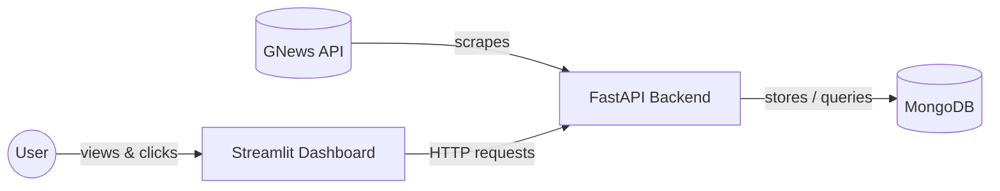

# 📰 Yazaki Morocco — News & Supply Chain Monitor

An automated news intelligence dashboard that continuously tracks what's being said — in **English, French, and Arabic** — about Yazaki, its OEM customers, its competitors, and the global shipping routes and ports its supply chain depends on.

---

## Why this project matters

Yazaki Morocco doesn't operate in isolation. Its business is directly exposed to:

- **Its OEM customers** (Renault, Stellantis, Peugeot, Citroën, Dacia) — a slowdown, plant announcement, or strategy shift at any of them has direct downstream consequences for Yazaki's own production planning.
- **Its direct competitors** (Sumitomo Electric, Leoni, Aptiv, Lear) — knowing what competitors are doing (expansions, contract wins, plant issues) is competitive intelligence that's otherwise scattered across dozens of sources.
- **Global shipping and logistics** — a container backlog at a Chinese port, congestion at Tanger Med, or disruption in the Suez Canal / Red Sea shipping lanes can delay raw materials in or finished goods out, often with days or weeks of lead time before it's felt on the factory floor.
- **Industry-wide shocks** — semiconductor shortages and other automotive supply chain disruptions have repeatedly caused production stoppages across the whole industry in recent years.

**The problem this solves:** relevant news about all of the above is published continuously, in three different languages, across hundreds of sources — no one person can manually monitor all of it every day. This project automates that monitoring, so the people who need this information get a single dashboard instead of hours of manual searching across multiple languages and sites.

**The result:** earlier visibility into supply chain risk, competitor activity, and customer news — the kind of early warning that turns a "we found out too late" situation into "we saw this coming."

---

## What it actually does

1. **Searches for news** matching a curated keyword list — company names, ports, logistics terms — across English, French, and Arabic sources, using the [GNews API](https://gnews.io).
2. **Filters out noise** — job postings and other irrelevant matches are automatically excluded, and duplicate articles (the same story picked up by multiple keyword searches) are deduplicated.
3. **Stores everything in MongoDB**, tagged with exactly which keyword(s) each article matched.
4. **Presents an interactive dashboard** where you can:
   - See today's and this month's totals and most-mentioned keyword at a glance
   - Browse activity by day, week, or month, broken down by language
   - Click any bar in the chart to see exactly which articles are behind it
   - Filter that article list by keyword, with direct links to the original source
5. **Updates incrementally** — click "Update now" and it only fetches what's changed since the last successful run, rather than re-fetching everything every time.

---

## Architecture



| Layer | Technology | Role |
|---|---|---|
| Database | MongoDB | Stores articles and scrape history |
| Backend | FastAPI (Python) | Scrapes GNews, matches keywords, exposes a REST API |
| Frontend | Streamlit (Python) | Interactive dashboard — charts, filters, article browsing |
| Data source | [GNews API](https://gnews.io) | News search, title/description matching |
| Orchestration | Docker Compose | Runs all three services together with one command |

---

## Project structure

```
news-scraper-ymo/
├── backend/
│   ├── app/
│   │   ├── main.py                  # FastAPI entrypoint
│   │   ├── config.py                # Environment settings
│   │   ├── database.py              # MongoDB connection + indexes
│   │   ├── models.py                # Data schemas
│   │   ├── repository.py            # All MongoDB queries
│   │   ├── keywords.py              # Multilingual keyword configuration
│   │   ├── routers/                 # API endpoints (articles, stats, update)
│   │   └── services/                # GNews client, keyword matching, scraping, stats
│   ├── requirements.txt
│   ├── Dockerfile
│   └── .env.example
├── frontend/
│   ├── app.py                       # Streamlit entrypoint
│   ├── config.py                    # Environment settings
│   ├── api_client.py                # All backend API calls
│   ├── components/                  # Overview bar, chart, article list
│   ├── requirements.txt
│   └── Dockerfile
├── docker-compose.yml
└── .gitignore
```

---

## Getting started

### Prerequisites

- [Docker Desktop](https://www.docker.com/products/docker-desktop/) installed and running
- A free GNews API key — [sign up here](https://gnews.io/register)

### Setup

1. **Clone the repo:**
   ```bash
   git clone https://github.com/yassinembasskar/news-scraper-ymo.git
   cd news-scraper-ymo
   ```

2. **Configure the backend.** Copy `backend/.env.example` to `backend/.env` and fill in your real values:
   ```
   MONGO_URI=mongodb://localhost:27017
   MONGO_DB_NAME=yazaki_news
   GNEWS_API_KEY=your_actual_gnews_api_key_here
   ```
   (`MONGO_URI` is automatically overridden inside Docker — no need to change it for the container setup.)

3. **Build and start everything:**
   ```bash
   docker compose up --build
   ```
   First run will take a few minutes (downloading images, installing dependencies). Subsequent runs are fast — see [Common operations](#common-operations) below.

4. **Open the dashboard:**
   ```
   http://localhost:8501
   ```

---

## Using the dashboard

- **Overview bar** — today's and this month's article totals and top keyword, plus when data was last refreshed.
- **"Update now"** — triggers a fresh scrape. Safe to click anytime: if it's already up to date for today, it does nothing rather than wasting API quota. A full run takes roughly 30–60 seconds due to deliberate rate-limiting on the free GNews plan.
- **Chart** — pick Day, Week, or Month, and navigate to any specific period (not just the current one). Bars are split by language (English / French / Arabic).
- **Click any bar** — the panel below updates to show that period's total, top keyword, per-language breakdown, and the actual list of articles.
- **Keyword filter** — narrows the article list only; it never changes the chart or the summary numbers above it.

---

## Configuration

**Keywords** — edit `backend/app/keywords.py` to add or remove search terms. Each language (`en`, `fr`, `ar`) has its own list, since company names need to be transliterated (not just translated) to actually match Arabic-language headlines — e.g. Renault appears as "رينو", not "Renault".

**Scrape window** — the first-ever run defaults to the last 7 days. Adjust `DAYS_BACK` in `backend/app/services/scraper.py` to change this.

**Excluded words** — `EXCLUDE_WORDS_BY_LANGUAGE` in `keywords.py` controls what gets filtered out (e.g. job postings). Add more terms per language as needed.

---

## Common operations

```bash
# Stop everything (containers stopped, not removed)
docker compose down

# Stop and restart later — fast, no rebuild needed
docker compose up

# After changing code — rebuilds only what changed
docker compose up --build

# View logs for one service
docker compose logs -f backend

# Full reset — wipes the database too (use with caution)
docker compose down -v
```

Your scraped articles and scrape history live in a Docker volume and persist across restarts — `docker compose down` alone never deletes your data.

---

## Known limitations

- **GNews free plan**: 100 requests/day, capped article results per request. A busy day with a lot of keyword chunks across three languages can approach this limit.
- **Single shared "last updated" watermark** across all languages — if one language fails during a run, the whole run is marked partial and retried together next time, rather than tracking each language independently.
- **Bucket boundaries use Morocco local time** (`Africa/Casablanca`), correctly accounting for its seasonal Ramadan time change — but this means an article published late at night UTC may appear to belong to "the next day" in the dashboard.