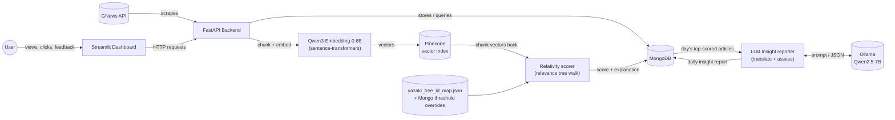

# 📰 Yazaki Morocco — News & Supply Chain Monitor

An automated news intelligence dashboard that continuously tracks what's being said — in **English, French, and Arabic** — about Yazaki, its OEM customers, its competitors, and the global shipping routes and ports its supply chain depends on. Beyond the dashboard, it also builds a **semantic index** of everything it collects and **automatically scores how relevant each article actually is** to Yazaki's business against a hand-built relevance tree — turning the article archive into something that can be searched, ranked, and reasoned over by meaning, not just keyword. Finally, a **local LLM (Qwen2.5-7B via Ollama)** turns each day's most relevant articles into a **daily insight report** — a short, structured assessment of which concrete SAP supply-chain parameter each event affects, in which direction, and what to do about it.

---

## Why this project matters

Yazaki Morocco doesn't operate in isolation. Its business is directly exposed to:

- **Its OEM customers** (Renault, Stellantis, Peugeot, Citroën, Dacia) — a slowdown, plant announcement, or strategy shift at any of them has direct downstream consequences for Yazaki's own production planning.
- **Its direct competitors** (Sumitomo Electric, Leoni, Aptiv, Lear) — knowing what competitors are doing (expansions, contract wins, plant issues) is competitive intelligence that's otherwise scattered across dozens of sources.
- **Global shipping and logistics** — a container backlog at a Chinese port, congestion at Tanger Med, or disruption in the Suez Canal / Red Sea shipping lanes can delay raw materials in or finished goods out, often with days or weeks of lead time before it's felt on the factory floor.
- **Industry-wide shocks** — semiconductor shortages and other automotive supply chain disruptions have repeatedly caused production stoppages across the whole industry in recent years.

**The problem this solves:** relevant news about all of the above is published continuously, in three different languages, across hundreds of sources — no one person can manually monitor all of it every day, and not every article that *mentions* a keyword is actually *relevant*. This project automates both the monitoring and the triage.

**The result:** earlier visibility into supply chain risk, competitor activity, and customer news — ranked by how relevant it actually is — the kind of early warning that turns a "we found out too late" situation into "we saw this coming."

---

## What it actually does

1. **Searches for news** matching a curated keyword list — company names, ports, logistics terms — across English, French, and Arabic sources, using the [GNews API](https://gnews.io).
2. **Filters out noise** — job postings and other irrelevant matches are automatically excluded, and duplicate articles (the same story picked up by multiple keyword searches) are deduplicated.
3. **Stores everything in MongoDB**, tagged with exactly which keyword(s) each article matched.
4. **Presents an interactive dashboard** where you can:
   - See today's and this month's totals and most-mentioned keyword at a glance
   - Browse activity by day, week, or month, broken down by language
   - Click any bar in the chart to see exactly which articles are behind it
   - Filter that article list by keyword (a case-insensitive search across title *and* extracted content, not just the tag it was originally found under)
   - See every article ranked by **relativity score**, color-coded at a glance
5. **Updates incrementally** — click "Update now" and it only fetches what's changed since the last successful run, rather than re-fetching everything every time.
6. **Extracts full article text** — click "Extract articles" and it opens each not-yet-extracted article in a real headless browser, pulls out the main body text (skipping ads/navigation/cookie banners), and saves it. Articles it can't extract automatically (paywalls, cookie walls, unusual page layouts) can be retried or have their content pasted in manually.
7. **Embeds and indexes article content** — click "Embed articles" and every successfully-extracted article is split into chunks, turned into vector embeddings, and upserted into a Pinecone vector index — the foundation for semantic search, retrieval, and the relevance scoring below.
8. **Scores every embedded article for relevance** — click "Relativity scoring" and each article's chunk embeddings are walked through a hand-built relevance tree (automotive industry → OEMs, competitors, ports, logistics, etc.) to produce a 0–100 relativity score, plus a full explanation of exactly which tree nodes it matched and why.
9. **Learns from feedback** — "👍 More" / "👎 Less" buttons on any scored article let a human correct the score directly, while also nudging the underlying tree's sensitivity so future articles benefit from the correction too.
10. **Lets you drill into any article** — "See more" opens a detail page with the full scraped text and a visual breakdown of every relevance-tree node it triggered.
11. **Generates daily insight reports with a local LLM** — a **Reports** calendar page where you can generate, for any day, an LLM assessment of that day's most-relevant articles: each genuinely operational event becomes a structured card (the affected **SAP parameter**, whether the effect is positive/negative/neutral, a confidence %, and a concrete recommended action), while off-topic articles are silently dropped. Non-English articles are **translated to English first** (and the translation is cached), because the model judges relevance far more reliably in English.

---

## Architecture



| Layer | Technology | Role |
|---|---|---|
| Database | MongoDB | Stores articles, scrape/extraction/embedding/scoring status + history, relativity-feedback threshold overrides, cached translations, and generated daily reports |
| Backend | FastAPI (Python) | Scrapes GNews, matches keywords, extracts article content, chunks + embeds content, scores relevance, generates daily LLM reports, exposes a REST API |
| Frontend | Streamlit (Python) | Interactive dashboard — charts, filters, ranked/color-coded article list, extraction + embedding + scoring controls, per-article detail page, and a daily-report calendar |
| Data source | [GNews API](https://gnews.io) | News search, title/description matching |
| Content extraction | Playwright + trafilatura | Loads each article in a headless browser and pulls out its main text |
| Embedding model | [Qwen3-Embedding-0.6B](https://huggingface.co/Qwen/Qwen3-Embedding-0.6B) via `sentence-transformers` | Turns article-text chunks into 1024-dimensional vectors, CPU inference, no LangChain |
| Vector store | [Pinecone](https://www.pinecone.io) | Stores and indexes chunk embeddings (index name: `yazaki`, cosine metric); also the source the scorer reads chunk vectors back from |
| Relevance tree | `backend/app/yazaki_tree_id_map.json` | A hand-built taxonomy of ~130 nodes (Automotive Industry → OEMs → specific manufacturers, ports, logistics, etc.), each with a per-language embedding and a similarity threshold |
| Insight LLM | [Qwen2.5-7B-Instruct](https://ollama.com/library/qwen2.5) (`q4_K_M`) via [Ollama](https://ollama.com) | Translates non-English articles and produces the structured daily insight assessments; runs in its own container, CPU inference, model auto-downloaded on first start into a local cache |
| Business logic | `backend/app/llm_insight_business_logic.md` + `llm_insight_sap_attributes.md` | Human-authored rules fed to the LLM — how to judge supply-chain relevance and the strict list of valid SAP parameters it may cite |
| Orchestration | Docker Compose | Runs all services together with one command; database sync between machines is a separate, explicit opt-in step (see [Syncing the database](#syncing-the-database-between-machines)) |

---

## Project structure

```
news-scraper-ymo/
├── backend/
│   ├── app/
│   │   ├── main.py                  # FastAPI entrypoint (incl. startup guard/state cleanup for all jobs)
│   │   ├── config.py                # Environment settings
│   │   ├── database.py              # MongoDB connection + indexes
│   │   ├── models.py                # Data schemas (statuses, run-status docs, scoring/translation/report fields)
│   │   ├── repository.py            # All MongoDB (and Pinecone-cleanup) queries
│   │   ├── keywords.py              # Multilingual keyword configuration
│   │   ├── yazaki_tree_id_map.json  # The relevance tree — ids, labels (en/fr/ar), per-language embeddings, thresholds
│   │   ├── embed_tree_labels.py     # One-off script that (re)computes the tree's embeddings
│   │   ├── llm_insight_business_logic.md   # LLM rules: how to judge supply-chain relevance + fill the report JSON
│   │   ├── llm_insight_sap_attributes.md   # The strict list of SAP parameters the LLM may cite
│   │   ├── routers/                 # API endpoints (articles, extraction, embedding, scoring, reports, stats, update)
│   │   └── services/                # GNews client, keyword matching, scraping, stats, extraction,
│   │                                 # chunking, embedding, relativity scoring, LLM insight + report job
│   ├── extracted_articles/          # .txt output of successful extractions (not in a Docker volume)
│   ├── yazaki_news/                 # mongodump snapshot checked into git — see "Syncing the database"
│   ├── test_extraction.py           # Standalone Playwright/trafilatura proof-of-concept script
│   ├── requirements.txt
│   ├── Dockerfile
│   └── .env.example
├── frontend/
│   ├── app.py                       # Streamlit entrypoint — thin router (st.navigation, no visible page nav)
│   ├── config.py                    # Environment settings
│   ├── api_client.py                # All backend API calls
│   ├── views/                       # dashboard.py (main page), article_detail.py ("See more" page),
│   │                                 # reports.py (daily-report calendar)
│   ├── components/                  # Overview bar (update/extract/embed/score controls + progress),
│   │                                 # chart, article list (ranking, colored scores, feedback buttons)
│   ├── requirements.txt
│   └── Dockerfile
├── docker-compose.yml               # incl. the ollama service + the opt-in ("sync" profile) mongo-restore service
├── llm_model/                       # Ollama model cache — machine-local, git-ignored, auto-populated on first run
└── .gitignore
```

---

## Getting started

### Prerequisites

- [Docker Desktop](https://www.docker.com/products/docker-desktop/) installed and running
- A free GNews API key — [sign up here](https://gnews.io/register)
- A [Pinecone](https://www.pinecone.io) account and API key, with an index named `yazaki` created (dimension `1024`, metric `cosine`) — needed for both embedding and relativity scoring (the scorer reads chunk vectors back from the same index)
- (Optional) A Hugging Face token if you ever need to re-download the embedding model — see the note on the model cache below

### Setup

1. **Clone the repo:**
   ```bash
   git clone https://github.com/yassinembasskar/news-scraper-ymo.git
   cd news-scraper-ymo
   ```

2. **Configure the backend.** Copy `backend/.env.example` to `backend/.env` and fill in your real values:
   ```
   MONGO_URI=mongodb://localhost:27017
   MONGO_DB_NAME=yazaki_news
   GNEWS_API_KEY=your_actual_gnews_api_key_here
   HF_TOKEN=your_huggingface_token_here
   PINECONE_API_KEY=your_pinecone_api_key_here
   ```
   (`MONGO_URI` is automatically overridden inside Docker — no need to change it for the container setup.)

3. **Seed the embedding model cache (one-time, first setup only).** The Qwen3-Embedding-0.6B model is *not* downloaded during the Docker build — it lives in a persistent named volume (`hf-model-cache`) instead, because some corporate networks block outbound access to `huggingface.co` (see [Known limitations](#known-limitations)). On a machine with normal internet access:
   ```bash
   pip install sentence-transformers
   python -c "from sentence_transformers import SentenceTransformer; SentenceTransformer('Qwen/Qwen3-Embedding-0.6B')"
   ```
   Then copy the resulting `~/.cache/huggingface` folder into the running `backend` container's `hf-model-cache` volume via `docker cp` (start the stack first, then copy, then restart backend). If your network already reaches `huggingface.co` fine, you can skip this — the model will simply download on first use instead.

4. **Build and start everything:**
   ```bash
   docker compose up --build
   ```
   First run will take a few minutes (downloading images, installing dependencies). The **`ollama` service also downloads the insight model** (`qwen2.5:7b-instruct-q4_K_M`, ~4.7 GB) into a local `llm_model/` cache the first time — this happens automatically in the background and only once per machine; the model server reports healthy once it's finished. It starts with whatever's already in the `mongo` volume — see [Syncing the database](#syncing-the-database-between-machines) if you want to load the committed snapshot instead. Subsequent runs are fast — see [Common operations](#common-operations) below.

5. **Open the dashboard:**
   ```
   http://localhost:8501
   ```

---

## Using the dashboard

- **Overview bar** — today's and this month's article totals and top keyword, when data was last refreshed, and the **Update / Extract articles / Embed articles / Relativity scoring** controls (each with a live progress bar + ETA while running, and a "🛑 Stop" button in its place once a run is in flight).
- **"Update now"** — triggers a fresh scrape. Safe to click anytime: if it's already up to date for today, it does nothing rather than wasting API quota. A full run takes roughly 30–60 seconds due to deliberate rate-limiting on the free GNews plan.
- **Chart** — pick Day, Week, or Month, and navigate to any specific period (not just the current one). Bars are split by language (English / French / Arabic).
- **Click any bar** — the panel below updates to show that period's total, top keyword, per-language breakdown, and the actual list of articles, **ranked by relativity score** (highest first; not-yet-scored articles sort to the end).
- **Keyword filter** — narrows the article list only; it never changes the chart or the summary numbers above it.
- **Each article's row** shows its title/link, language, publish date, source, extraction/embedding/scoring status, matched keywords, a color-coded relativity score, feedback buttons, and a "See more" link to its detail page.
- **"📄 Daily Insight Reports"** (link at the top of the dashboard) opens the report calendar — generate and browse per-day LLM insight briefs (see [Daily insight reports](#daily-insight-reports-local-llm)).

---

## Article content extraction

Every article has an `ingestion_status`, separate from whether it's been *found* by the scraper:

| Status | Meaning |
|---|---|
| `No Extraction` | Default state for every newly-scraped article — nothing attempted yet. |
| `Pending` | An extraction attempt is currently in progress for this article. |
| `Successful` | Full body text was extracted (or manually pasted) and is stored. |
| `Failed` | An attempt was made but no usable content came back (paywall, cookie wall, unsupported layout, page didn't load). |
| `Expired` | Published more than a month ago — content (if any) is purged and it's excluded from future automatic extraction. |

**"🧹 Extract articles"** (next to "Update now" in the overview bar) starts a background job and returns immediately — it doesn't block the page. Each run:
1. **Expires** any article published more than a calendar month ago, regardless of its current status, clearing its stored content (and, if it had been embedded, its Pinecone vectors and embedding fields too — see below).
2. **Extracts** every remaining `No Extraction` article: opens it in a headless Chromium browser (via Playwright), pulls the main body text with `trafilatura`, and on success saves the text both to that article's database row and to `backend/extracted_articles/{title[:40]}.txt`.
3. `Failed` articles are **not** retried automatically on the next run — that's a deliberate choice, so the job doesn't keep re-attempting articles that structurally can't be extracted. Reload the article list after a minute or two to see progress; articles show `Pending` while being worked on.

Only one extraction can run at a time (an in-memory lock) — clicking the button again while one is running just reports "already in progress" instead of starting a second one. If the backend restarts mid-run (crash or redeploy), any article left stuck at `Pending` is automatically reset to `No Extraction` on the next startup, so nothing is permanently stranded.

**Recovering `Failed` articles** — each `Failed` article in the article list gets two options:
- **🔁 Retry automatic extraction** — re-attempts just that one article synchronously (useful if the first failure was transient, e.g. a slow page load).
- **Paste content manually** — an expandable text box to paste the article's text by hand; saved exactly as a successful automatic extraction would be.

---

## Semantic embeddings & Pinecone

Every successfully-extracted article can be turned into searchable vector embeddings — the groundwork for the relativity scoring below, and for future semantic search / "find related articles" / retrieval-augmented Q&A over the whole archive. Built with plain `sentence-transformers`, `pymongo`, and the `pinecone` client directly — no LangChain or other orchestration framework.

Each article has an `embedding_status`, independent of `ingestion_status`:

| Status | Meaning |
|---|---|
| `Not Embedded` | Default state — either never attempted, or not eligible yet (only `Successful`-extraction articles are ever candidates). |
| `Pending` | Currently being chunked/embedded/upserted. |
| `Embedded` | Its chunks are stored in Pinecone; `chunk_ids` and `number_of_chunks` are recorded on the article. |
| `Failed` | An attempt was made but something went wrong (chunking, embedding, or the Pinecone upsert); retried automatically on the next run. |

**"🧠 Embed articles"** starts a background job:
1. **Gathers** every article with `ingestion_status == "Successful"` and `embedding_status != "Embedded"` — a `Failed`/`Pending`/`Expired`-extraction article is never touched, enforced both by the query and by a hard guard at the database-write level.
2. **Chunks** each article's content on line breaks (`services/chunking.py`), embeds every chunk with **Qwen3-Embedding-0.6B**, and upserts the resulting vectors into the Pinecone index `yazaki` in batches, tagged with `article_id`, `url`, `order`, `language`, and the chunk's own text as metadata.
3. **Tracks live progress** in a `meta` document — total candidates, processed count, and a recency-weighted (exponential moving average) estimate of seconds-per-article, so one anomalously slow article (e.g. a cold-start warmup right after a container restart) doesn't permanently skew the ETA.
4. **Logs** one `embedding_runs` document per run (status, counts, errors) — a permanent history, separate from the `meta` document that only reflects the current/most recent run.

While a run is active, the overview bar shows a progress bar and an ETA, and the button becomes **"🛑 Stop embedding"** — this asks the run to stop after its current article finishes (there's no safe way to interrupt Python mid-computation), then resets the guard flag and any `Pending` article back to a clean state. The same guard-reset also runs automatically on backend startup, in case the process was killed outright rather than shut down cleanly.

**Expiry cleanup** — when `expire_old_content()` marks an article `Expired`, it also deletes that article's vectors from Pinecone (via its stored `chunk_ids`) in the same step, so Mongo and Pinecone never drift out of sync with each other.

---

## Relativity scoring

Not every article that matches a keyword is actually relevant to Yazaki's business — a wire-service story that happens to mention "Renault" once is not the same as a piece about Renault's EV platform strategy. Relativity scoring is a **0–100 score, computed per article**, that captures the difference — the score every article is ranked by in the dashboard.

### The relevance tree

`backend/app/yazaki_tree_id_map.json` is a hand-built taxonomy — roughly 130 nodes rooted under things like *Automotive Industry*, branching down through *OEM & Vehicle Manufacturing*, *Electric & Hybrid Vehicle Transition*, *Automotive Wiring Competitors* (Yazaki's actual competitors), ports, and logistics. Every node has:
- A label in each of the three languages (`en`/`fr`/`ar`)
- A **per-language embedding** of that label (computed once by `embed_tree_labels.py`)
- A **similarity threshold** (default `0.4`) — how close a chunk's embedding must be, in cosine similarity, to count as a match

### How an article gets scored

For each of an article's chunks (fetched back from Pinecone, embedding + language included), the scorer walks the tree from every root:
1. At each node, compute cosine similarity between the chunk's embedding and **that node's same-language embedding** (an Arabic chunk is only ever compared against Arabic tree labels, never English/French — see `scorer.py`'s `_walk`).
2. Below the node's threshold → stop descending this branch for this chunk.
3. At/above threshold → if the node has children, keep descending; if it's a structural leaf (or none of its children cleared their own threshold), record a **hit**.
4. Hits from every chunk are grouped by node, then combined into a final score: the single best-matching node's `similarity ** 1.8` (an exponent that compresses mid-range similarities much more than high ones, so only genuinely strong matches approach 100), plus small bonuses for how many *different* nodes were triggered (breadth) and how much of the article's content reached a true leaf node (volume/density).
5. The result — `relativity_score` (0–100) and a full `score_explanation` (which nodes triggered, at what similarity, leaf or branch, which chunks supported each one) — is saved on the article.

Each article has a `scored_status`, mirroring the other jobs:

| Status | Meaning |
|---|---|
| `Not Scored` | Default — not attempted yet, or not eligible (only `Embedded` articles are candidates). |
| `Pending` | Currently being scored. |
| `Scored` | Has a `relativity_score` and `score_explanation`. |
| `Failed` | Something went wrong (e.g. a chunk's vector wasn't found in Pinecone); retried automatically next run. |

**"🎯 Relativity scoring"** starts a background job with the same progress/ETA/stop mechanics as embedding. Its guard, progress tracking, and startup crash-recovery all mirror the embedding job exactly (see `scoring_job.py`, a near-identical structure to `embedder.py`).

### Feedback: teaching the tree

Every scored article gets two feedback buttons plus a rescore button:

- **👍 More** / **👎 Less** — tells the system this article is more, or less, relevant than its score suggests. Each click does two things at once:
  1. **Nudges the threshold** of every tree node this article's scoring run triggered, scaled by how much of the article actually supported that node (a node backed by 8 of 10 chunks moves close to the full step; one backed by a single stray chunk barely moves at all). These nudges are stored as overrides in a `node_threshold_overrides` Mongo collection — not written into the tree file itself — so they apply to every future scoring run without ever touching the ~130-node source file. *(This mostly shapes how future/other articles score; a small threshold shift rarely flips a similarity that was already well clear of the line.)*
  2. **Directly adjusts this article's own score** by ±5 points (`relativity_score_adjustment`, clamped so the final score stays in 0–100) — the part that guarantees the number you're looking at actually moves. This adjustment is remembered and re-applied every time the article is rescored, including in a full bulk run, so it's never silently lost.
- **🔄 Rescore** — re-runs scoring for just this one article against the tree as it currently stands (including any threshold overrides *other* articles' feedback has accumulated, and this article's own existing adjustment) — no feedback given, nothing changed. Useful after the tree has moved since this article was last scored.

### Article detail page

Click **"See more"** on any article to open a dedicated page (no visible page-switcher UI — it's reached only via that button) showing:
- The full scraped content
- The relativity score, same color coding as the list
- Every triggered relevance node, as a root-to-leaf breadcrumb (e.g. *Automotive Industry › Electric & Hybrid Vehicle Transition › Hybrid Vehicle Platforms*), with a similarity bar, a Leaf/Branch tag, how many chunks supported it, and the single best (primary) match flagged 🎯

---

## Daily insight reports (local LLM)

Relativity scoring answers *"is this article on-topic?"*. The report stage answers a sharper question: *"does this describe a concrete event that affects a specific supply-chain parameter, and if so, what should we do about it?"* — and writes the answer as a short, structured daily brief. It runs a **local** LLM (Qwen2.5-7B-Instruct via [Ollama](https://ollama.com), quantized `q4_K_M`, ~5.5 GB to run, CPU-only) in its own container — no data leaves the machine, no external LLM API.

### The Reports calendar

A dedicated **"📄 Daily Insight Reports"** page (linked from the dashboard) shows a month calendar. Each day is marked:

| Marker | Meaning |
|---|---|
| `· N` | Not generated yet — the day has **N** candidate articles (scored ≥ 60, not expired) awaiting a report |
| 🔴 `N` | Generated — the report found **N** relevant insights |
| ✅ | Generated — ran successfully but found nothing operationally relevant that day |
| *(plain number)* | No candidate articles and no report |

Clicking a day shows its insight cards, a *"no relevant insights for this day"* message (if it was generated empty), or a **Generate report** button (if it hasn't been run). A day can be regenerated at any time.

### How a report is generated

**Generation is a background job** — a busy day (dozens of articles, each a separate LLM pass on CPU) can take many minutes, so clicking **Generate** kicks off the run and the page shows a live progress bar + ETA + stop button, exactly like the embedding/scoring jobs. It also shares the same **single-stage-at-a-time guard**: report generation never runs concurrently with extraction/embedding/scoring (they'd fight for CPU), and its guard flag resets on backend startup after a crash.

For the chosen day, the job:

1. **Gathers candidates** — every article published that (UTC) day with `relativity_score ≥ 60` that isn't `Expired` (an expired article's content has been purged, so it can't be assessed and is excluded — it counts as 0 on the calendar).
2. **Translates non-English articles to English first**, and **caches the translation** on the article (`translated_title` / `translated_content`, `translation_status`). This matters: testing showed the model reliably judges relevance in English but silently misses the *same clearly-relevant event* when it's in Arabic. Caching means each non-English article is translated only once, ever — every later report run reuses the stored English instead of paying the translation call again.
3. **Assesses each article one at a time** against the business-logic rules (batching multiple articles into one prompt was found to make the model lazily skip reasoning). Output is constrained to a strict JSON schema, so every relevant result is a clean object:
   ```json
   {
     "title": "Houthi group announces maritime blockade against Saudi Arabia",
     "confidence": 90,
     "concerned_param": "EORD-FLIFN",
     "effect": "negative",
     "recommended_action": "Block this route in the source list and reroute sourcing — this is a closure, not a delay."
   }
   ```
   Off-topic articles (a car-model launch, a competitor's award) return nothing and simply don't appear in the report.
4. **Stores one report document** per day in the `daily_reports` collection (keyed by date). An empty report is a real, distinct result ("processed, nothing relevant") — not the same as a day that was never generated.

### The business logic (human-authored)

Two Markdown files, fed to the model alongside each article, are the editable "brain" of this stage — no code change needed to tune its judgment:

- **`backend/app/llm_insight_business_logic.md`** — how to decide relevance, how to classify a disruption (Port Congestion / Total Blockade / Capacity Change), how to reason about SAP impact (including the MRP backward-scheduling logic), how to set `confidence`, and worked examples. `concerned_param` stays a single field even for dual-impact events (e.g. a blockade *threat* that's between a delay and a closure); the `recommended_action` sentence carries the nuance a single field can't.
- **`backend/app/llm_insight_sap_attributes.md`** — the strict, authoritative list of SAP parameters the model is allowed to cite (e.g. `MARC-PLIFZ` planned delivery time, `MARC-EISBE` safety stock, `EORD-FLIFN` source-list block, plus outbound `VBEP`/`LIKP`/`VBAK`). Anything not on this list is off-limits — an event with no matching parameter comes back "not relevant" rather than being force-fit onto the wrong field.

Edit these two files to change what the reports flag and how — extend the SAP list, add few-shot examples, refine the classification rules.

---

## Configuration

**Keywords** — edit `backend/app/keywords.py` to add or remove search terms. Each language (`en`, `fr`, `ar`) has its own list, since company names need to be transliterated (not just translated) to actually match Arabic-language headlines — e.g. Renault appears as "رينو", not "Renault".

**Scrape window** — the first-ever run defaults to the last 7 days. Adjust `DAYS_BACK` in `backend/app/services/scraper.py` to change this.

**Excluded words** — `EXCLUDE_WORDS_BY_LANGUAGE` in `keywords.py` controls what gets filtered out (e.g. job postings). Add more terms per language as needed.

**Extraction expiry window** — articles are expired one calendar month after `published_at`. Adjust `EXPIRY_MONTHS` in `backend/app/services/extractor.py` to change this.

**Embedding model / index** — `EMBEDDING_MODEL_NAME` and `PINECONE_INDEX_NAME` in `backend/app/services/embedder.py` (the latter must match the constant of the same name in `repository.py` and `scorer.py`, used for the expiry-cleanup and scoring read-back paths). `UPSERT_BATCH_SIZE` / `PINECONE_DELETE_BATCH_SIZE` control Pinecone batch sizes; `RATE_EMA_ALPHA` controls how quickly the reported ETA reacts to a change in processing speed.

**Relativity scoring** — all in `backend/app/services/scorer.py`:
- `SCORE_POWER` (default `1.8`) — the exponent applied to a node's similarity; higher values compress mid-range scores further toward 0.
- `LEAF_MULTIPLIER`, `BREADTH_BONUS_STEP` / `BREADTH_BONUS_MAX_EXTRA_NODES`, `VOLUME_BONUS_PER_CHUNK` / `VOLUME_BONUS_CAP`, `DENSITY_BONUS_WEIGHT` / `DENSITY_BONUS_FRACTION_THRESHOLD` — the bonus terms described above.
- `FEEDBACK_STEP` (default `0.02`) and `FEEDBACK_THRESHOLD_MIN`/`MAX` (`0.1`–`0.9`) — the per-click tree-threshold nudge and its bounds.
- `FEEDBACK_SCORE_STEP` (default `5`, in `routers/scoring.py`) — the direct per-click score adjustment.
- Per-node thresholds live in `yazaki_tree_id_map.json` itself (baseline, default `0.4` for every node) — re-run `embed_tree_labels.py` if you ever change the tree's structure or labels.

**LLM insight reports:**
- **Model** — `OLLAMA_MODEL` (default `qwen2.5:7b-instruct-q4_K_M`) in `backend/app/config.py`; must match the model the `ollama` service pulls in `docker-compose.yml`. `OLLAMA_HOST` points the backend at the Ollama container. The model choice is a deliberate fit for the target hardware (no GPU, ~16 GB RAM shared across the whole stack) — larger models risk swap-thrashing.
- **Candidate threshold** — `MIN_RELATIVITY_SCORE` (default `60`) in `backend/app/services/report_job.py` decides which of a day's scored articles get assessed.
- **Judgment / rules** — the two `llm_insight_*.md` files (see [Daily insight reports](#daily-insight-reports-local-llm)); no code change needed to retune.
- **Decoding** — `num_ctx` (`8192`) and `temperature` (`0.2`) in `backend/app/services/llm_insight.py`. The context override is required: Ollama's 4096 default silently truncates a real article + the business-logic prompt, and the low temperature keeps the structured field choices stable.

---

## Syncing the database between machines

The database isn't a Docker named volume shared across machines — it's local to whichever machine's Docker Desktop is running it. To carry your data (scraped articles, extraction/embedding/scoring progress) from one machine to another, the project uses a **git-committed MongoDB dump**:

- `backend/yazaki_news/` is a `mongodump` snapshot of every collection (`articles`, `meta`, `scrape_runs`, `extraction_runs`, `embedding_runs`, `scoring_runs`, `node_threshold_overrides`, `daily_reports`), checked into the repo.
- The `mongo-restore` service in `docker-compose.yml` restores this snapshot into the `mongo` container's database — but it is **opt-in**, behind Compose's `sync` profile. A plain `docker compose up` (with or without `--build`) never touches it.

> This used to run automatically on every `docker compose up`, silently dropping and overwriting the live database on any unrelated rebuild/restart — that turned out to be actively dangerous (it once wiped out an in-progress scoring run). It's opt-in now specifically to prevent that.

### Running the app normally

```bash
docker compose up --build -d
```
Starts Mongo (with whatever's already in its volume — unchanged unless you explicitly sync), backend, and frontend. Safe to run as often as you like; never touches the database.

### Pulling the latest committed snapshot (explicit, when you actually want it)

```bash
docker compose --profile sync up mongo-restore
```
This **drops and replaces** the local database with whatever's currently in `backend/yazaki_news/`. Only run this when you deliberately want to sync in someone else's (or another machine's) committed data — any local changes made since your own last dump are lost unless you've dumped and committed them first.

### Saving your current database state (before switching machines, or just to back it up)

```bash
docker exec news-scraper-ymo-mongo-1 mongodump --uri="mongodb://localhost:27017" --db=yazaki_news --out=/tmp/dump
docker cp news-scraper-ymo-mongo-1:/tmp/dump/yazaki_news/. backend/yazaki_news/
docker exec news-scraper-ymo-mongo-1 rm -rf /tmp/dump
```

> **Windows/Git Bash users:** the `/tmp/dump` and `container:/path` arguments above can get silently mangled into bogus Windows paths by Git Bash's automatic MSYS path conversion, making the commands *look* like they succeeded while writing nothing useful. If you hit this, prefix each line with `MSYS_NO_PATHCONV=1` and use a relative path (`backend/yazaki_news/`, not an absolute one) for the `docker cp` destination.

Then review and push:
```bash
git status
git add backend/yazaki_news
git commit -m "Sync database"
git push
```

On the other machine: `git pull`, then `docker compose --profile sync up mongo-restore` to load it in.

To stop the containers (without touching the database either way):
```bash
docker compose down
```

---

## Common operations

```bash
# Stop everything (containers stopped, not removed)
docker compose down

# Normal start/restart — never touches the database
docker compose up --build -d

# Restart just backend/frontend after a code change
docker compose up --build -d backend frontend

# Explicitly pull the latest committed database snapshot (opt-in, overwrites local data)
docker compose --profile sync up mongo-restore

# View logs for one service
docker compose logs -f backend

# Full reset — wipes the database volume too (use with caution)
docker compose down -v
```

---

## Known limitations

- **GNews free plan**: 100 requests/day, capped article results per request. A busy day with a lot of keyword chunks across three languages can approach this limit.
- **Single shared "last updated" watermark** across all languages — if one language fails during a run, the whole run is marked partial and retried together next time, rather than tracking each language independently.
- **Bucket boundaries use Morocco local time** (`Africa/Casablanca`), correctly accounting for its seasonal Ramadan time change — but this means an article published late at night UTC may appear to belong to "the next day" in the dashboard.
- **Extracted `.txt` files aren't in a Docker volume** — they're written to `backend/extracted_articles/` inside the backend container's writable layer, so they're lost on `docker compose down` (the database copy of the content survives, since Mongo's volume is separate). Add a volume mount if you need them to persist.
- **The extraction lock is in-memory and per-process** — it correctly prevents two overlapping runs within a single backend container, but wouldn't coordinate across multiple backend replicas if this were ever scaled horizontally. The embedding and scoring jobs' guards, by contrast, are Mongo-backed and do survive a restart (and are automatically reset on backend startup if a process was killed mid-run).
- **Backend Docker image is heavier** — installing Chromium (`playwright install --with-deps chromium`) adds real build time and image size versus the rest of the stack.
- **Embedding and scoring are CPU-only** — no GPU acceleration. Embedding throughput is roughly 5–45 seconds/article depending on the machine; scoring is much faster (~1–2 seconds/article, since it's mostly Pinecone reads + cosine similarity, no model inference). The very first article after a fresh container start is often markedly slower (one-time model/thread warmup) — the ETA display is recency-weighted specifically to not be thrown off by this.
- **The scoring calibration is heuristic, not learned** — `SCORE_POWER` and the bonus weights in `scorer.py` were hand-tuned against a sample of real articles to hit a target score *distribution*, not trained against labeled ground truth. The feedback buttons let you correct individual articles and nudge the tree over time, but there's no formal retraining loop.
- **Relativity feedback is global, not per-user** — a threshold override from one person's "more"/"less" click affects every future article for everyone, since there's no per-user or per-session scoping. On a shared deployment, conflicting feedback from different people will fight each other.
- **No search/query endpoint yet** — the embedding pipeline populates Pinecone and the scorer reads from it, but there's currently no API or UI feature to directly query the vector index (semantic search, related-article lookup, RAG-style Q&A) outside of the relevance-tree walk.
- **Daily reports don't deduplicate yet** — the same event covered by several outlets produces several near-identical cards (a real day once yielded 8 separate cards for a single Red Sea blockade story). Merging duplicate stories into one insight is the obvious next step, not yet built.
- **Report generation is slow and CPU-bound** — a 7B model on CPU runs at roughly one article per ~30–60 seconds (translation, when needed, adds a call), so a busy day's report can take 30+ minutes. It's designed as an occasional, once-a-day background job, not something to run interactively; while it runs it holds the single-stage guard, blocking embedding/scoring/extraction.
- **LLM judgment quality is capped by the 7B model** — it's the practical ceiling for CPU + ~16 GB RAM. If a report's calls look weak, the first lever is refining the two `llm_insight_*.md` files, not a bigger model. The `confidence` % is the model's own estimate and is **not** calibrated — treat it as a rough hint, not a probability.
- **Report day boundaries are UTC**, while the dashboard's charts bucket by Morocco local time — an article published near midnight can land on a different "day" in the report calendar than in the dashboard chart.
- **Corporate SSL inspection can block outbound HTTPS from inside Docker** on some networks (observed against both `gnews.io` and `huggingface.co`) — this is why the embedding model is seeded via a persistent volume rather than downloaded at build/run time. If you hit `SSLError: self-signed certificate in certificate chain`, this is almost certainly why; resolving it requires either the corporate proxy's CA certificate or an SSL-inspection bypass for the relevant domains from your IT department.
- **`mongo-restore` is drop-and-replace only** — see [Syncing the database between machines](#syncing-the-database-between-machines). There is no merge option, and since it's opt-in you're responsible for remembering to dump + commit before switching machines.
