# 📰 News Intelligence & Business-Relevance Platform

An automated news intelligence pipeline that continuously tracks what's being said — in **multiple languages at once** — about the companies, competitors, and logistics networks a business depends on. It doesn't just collect articles: it groups same-day coverage of the same story into a single cluster, condenses each cluster down to its non-redundant substance, extracts and tracks the real-world entities involved across every cluster it ever appears in, and links each story to the earlier clusters most likely to be a related past event. A **local LLM** (no external AI API — runs fully offline, on your own hardware) then turns each day's articles into a **daily insight report**: a short, structured assessment of which concrete operational parameter each event affects, in which direction, and what to do about it.

Every part of *what* the platform tracks and *how* it judges relevance — keywords, the LLM's business rules — lives in a handful of plain config files, not in application code. This repo ships with a **working reference configuration** built for one real deployment (a Yazaki Morocco automotive-supply-chain use case) so the whole pipeline is demonstrably functional end to end, not a template with a business logic gap in the middle. Repointing it at a different company/industry means editing those config files — see [Adapting this to your organization](#adapting-this-to-your-organization) — not touching the backend, frontend, or pipeline logic.

---

## The problem this solves

No company operates in isolation. Almost every business has some version of the same exposure:

- **Customers** — a slowdown, plant announcement, or strategy shift at a major customer has direct downstream consequences for your own planning.
- **Competitors** — knowing what competitors are doing (expansions, contract wins, plant issues) is competitive intelligence that's otherwise scattered across dozens of sources.
- **Suppliers and logistics** — a port backlog, a shipping-lane disruption, or a key supplier's plant issue can delay materials in or goods out, often with days or weeks of lead time before it's felt operationally.
- **Industry-wide shocks** — sector-specific disruptions (shortages, regulatory shifts, macro events) repeatedly cause knock-on effects across an entire industry.

Relevant news about all of the above is published continuously, often in multiple languages, across hundreds of sources — no one person can manually monitor all of it every day, and not every article that *mentions* a tracked name is actually *relevant*. This platform automates both the monitoring and the triage: it turns "read the news yourself and hope you didn't miss anything" into a deduplicated, clustered, contextualized, and LLM-summarized stream, giving earlier visibility into risk, competitor activity, and customer news than manual monitoring realistically can — the kind of early warning that turns a "we found out too late" situation into "we saw this coming."

**The included reference configuration** points all of this at a real example: Yazaki Morocco's automotive supply chain — its OEM customers (BMW, Renault/Dacia, Stellantis, Ford, JLR, Mercedes, Toyota, Honda, Nissan, Volvo), its direct competitors (Sumitomo Electric, Leoni, Aptiv, Lear, Motherson, Kromberg & Schubert, Draexlmaier), and the ports/shipping lanes its EMEA manufacturing footprint depends on (Tanger Med, Algeciras, Suez/Red Sea, and others). It's there to prove the pipeline works end to end against a real domain, not as the platform's actual scope.

---

## What it actually does

1. **Searches for news** matching a curated keyword list — company names, places, logistics terms, whatever matters to your configuration — across as many languages as you configure, pulling from **five independent free news APIs at once** (GNews, NewsAPI.org, NewsData.io, Currents, TheNewsAPI.com) — see [News sources](#news-sources) for signup links and what each one adds.
2. **Filters out noise** — irrelevant matches (e.g. job postings) are automatically excluded, and duplicate articles (the same story picked up by multiple keyword searches, or independently found by more than one of the five sources) are deduplicated.
3. **Title-gates every new article** — before any expensive work happens, an embedding classifier judges whether the headline could plausibly matter to the tracked business. A title that fails is archived immediately (never extracted, clustered, or reported on); everything else proceeds. See [The title gate](#the-title-gate).
4. **Stores everything in MongoDB**, tagged with exactly which keyword(s) each article matched.
5. **Clusters each day's gated articles into stories**, extracts the full text of every clustered article, condenses each cluster down to its deduplicated, non-redundant content, extracts and canonicalizes the real-world entities it mentions, links it to earlier clusters covering a related past event, and generates structured LLM insights straight from that cluster — six automated phases described in [Preprocessing pipeline](#preprocessing-pipeline).
6. **Presents an interactive dashboard** where you can:
   - See today's and this month's totals and most-mentioned keyword at a glance
   - Browse a day-by-day grid of every day scraped so far, color-coded by title-gate/clustering status
   - Click any day to see its clusters, and any cluster to see its condensed content, entities, similar past clusters, generated insights, and full member articles
   - Trigger and monitor the title-gate and preprocessing stages, each with a live progress bar, ETA, and stop button
   - Review daily LLM insight reports right below the cluster browser
7. **Updates incrementally** — click "Update now" and it only fetches what's changed since the last successful run, rather than re-fetching everything every time.
8. **Generates LLM insights automatically, per cluster** — the last preprocessing phase feeds each contextualized cluster's condensed content (plus its similar-past-clusters context) to a local LLM: each genuinely operational event becomes a structured card (the affected **operational parameter**, whether the effect is positive/negative/neutral, a confidence %, and a concrete recommended action, citing exactly which content chunks support it), while stories with nothing operationally relevant produce none. There's no "Generate" button to click — it runs as part of the normal preprocessing backlog, same as clustering or entity extraction.
9. **Reviews archived/titled-out articles** — a dedicated page lists every article the title gate archived, with a one-click "disarchive" to send a wrongly-archived article back into the pipeline, and a "flush" to permanently delete the rest.
10. **Shows pipeline run history** — a Logs page lists every past run of every stage (scrape/title-gate/preprocessing), how long it took, and — for preprocessing — a breakdown of time spent in each of its six phases.

---

## KPIs & operational metrics

The point of the pipeline isn't just "more articles" — it's a small number of numbers that tell you whether the system is actually doing its job and what it's finding. Some of these are already computed and visible today; others are straightforward extensions of data the app already collects (flagged below), useful to know about whether you're using the Yazaki reference config or your own.

| KPI | What it tells you | Status |
|---|---|---|
| **Articles/day, articles/month** | Raw ingestion volume, and whether coverage is keeping pace with your keyword list | ✅ Live — overview bar |
| **Title-gate funnel** (gated / archived / passed, day-level completeness) | How much of what's found is judged irrelevant before any expensive work happens, and whether gating has caught up with the scrape backlog | ✅ Live — `/stats/pipeline`'s `title_gate` block, plus per-day markers on the day/cluster grid |
| **Extraction funnel and success rate** (scoped to clustered articles only) | Where clustering/extraction candidates are right now, and what fraction actually yields usable text (paywalls, layout issues) vs. fails | ✅ Live — `/stats/pipeline`'s `extraction` block |
| **Preprocessing phase counts** (days clustered, articles extracted, clusters condensed / entity-extracted / contextualized / insight-generated) | Where the backlog is in the six-phase pipeline right now | ✅ Live — under the Preprocessing stage card, and per-day on the cluster grid |
| **Clustering quality** (articles/cluster, singleton-cluster rate) | Whether same-story articles are actually being grouped, or the algorithm is over/under-merging | 🔧 Not aggregated into a chart yet — every cluster's member count is already stored, just not summarized |
| **Contextualization hit rate** (fraction of contextualized clusters with ≥1 similar past cluster) | How often a story genuinely continues a past one vs. is something new — a very high or very low rate on real data would flag the similarity threshold as mistuned | 🔧 Not aggregated yet — `similar_clusters` is stored per cluster today |
| **Insight yield rate** (relevant insights ÷ clusters assessed) | How much of the contextualized backlog actually turns into an actionable insight vs. gets correctly discarded as not operationally concrete | ✅ Partially live per day (the report calendar shows `relevant_count` / `insights_generated_clusters` per day) — 🔧 aggregating across a month is a small addition |
| **Insight coverage** (clusters insight-generated ÷ clusters contextualized) | Whether phase 6 is keeping up with the rest of the backlog, per day | ✅ Visible on the calendar (`· N` = still pending) — 🔧 not yet summarized as a single % |
| **Pipeline latency** (avg seconds/item, per stage/phase) | How long each stage/phase actually takes on your hardware — used internally for live ETAs already, and now permanently logged per run (see the Logs page) | ✅ Live during a run (the ETA), plus permanent per-run history with a per-phase breakdown |
| **Duplicate/redundancy rate** | How much of what's ingested is actually the same handful of stories covered repeatedly | ✅ Directly addressed by clustering + condensation now — a real, measured problem before this redesign (see [Known limitations](#known-limitations)) |
| **API quota usage** | Headroom left on the news-source rate limit (relevant on any capped free/paid tier) | 🔧 Not tracked yet — a simple counter against the source's daily cap |

None of this requires touching the pipeline logic to add — it's all read off data the app already writes to Mongo. This is the section to extend first if you're evaluating this platform for a KPI dashboard / reporting use case, rather than the interactive triage UI it ships with today.

---

## Adapting this to your organization

The pipeline (scrape → title-gate → cluster → extract → condense → extract entities → contextualize → LLM report) is generic. Everything that makes it *about Yazaki specifically* lives in a small, fixed set of plain-text/config files — none of it is hardcoded in `backend/app/services/` or `backend/app/routers/`. To repoint the whole platform at a different company or industry, this is the complete list of what to touch:

| File | What it defines | Effort to replace |
|---|---|---|
| `backend/app/keywords.py` | Search terms per language — company names, competitors, ports/logistics terms, disruption-signal phrases | Rewrite the lists; keep the per-language + exclude-words structure |
| `backend/app/llm_insight_business_logic.md` | The LLM's rules for judging relevance and filling out a report card, including any company-context primer | Rewrite in plain English/Markdown — no code, no prompt-engineering framework |
| `backend/app/llm_insight_sap_attributes.md` | The strict list of "operational parameters" (SAP fields in the reference config) the LLM is allowed to cite | Swap for your own domain's field list — SAP-specific naming isn't required by anything downstream, it's just what the reference config models |
| `PINECONE_INDEX_NAME`, `MONGO_DB_NAME` | The vector index and database name (currently `yazaki`/`yazaki_news`) | Rename freely — referenced from `.env`/config, not hardcoded elsewhere |
| `title_gate_centroids.npz` (`backend/app/`) | The two reference vectors ("relevant" / "archived") the title-gate classifier compares every new title against | Retrain against your own domain's past title-gate decisions — see [The title gate](#the-title-gate); starting from the LLM gate function (`llm_insight.gate_title`, still callable) is the fastest path to a first batch of labels |

Everything else — the FastAPI backend, the React dashboard, the title-gate/preprocessing background jobs, the Docker Compose setup — is domain-agnostic and untouched by a re-target. There is no hand-built relevance taxonomy to maintain anymore (the old `yazaki_tree_id_map.json` tree-walk scorer was retired — see [Known limitations](#known-limitations)); relevance now falls out of title-gating, clustering, and the LLM's own judgment instead of a hand-tuned tree. The current repo state still carries the Yazaki name in a few identifiers (directory/collection/index names) as an artifact of the reference deployment it was built against; stripping those is a renaming pass, not a re-architecture.

---

## Architecture

```mermaid
flowchart LR
    subgraph Sources["5 news APIs (source_client.py)"]
      direction TB
      GNews[("GNews")]
      NewsAPIOrg[("NewsAPI.org")]
      NewsDataIO[("NewsData.io")]
      Currents[("Currents")]
      TheNewsAPI[("TheNewsAPI.com")]
    end
    Sources -->|scrapes, merges, dedupes| Backend["FastAPI Backend"]
    Backend -->|stores / queries| Mongo[("MongoDB")]
    Backend -->|classify title| Gate["Title-gate classifier\n(nearest-centroid, Qwen embeddings)"]
    Gate -->|relevant / archived| Mongo
    Mongo -->|day's gated articles| Cluster["Clustering\n(complete-linkage, per UTC day)"]
    Cluster -->|extract full text| Extract["Extraction\n(Playwright + trafilatura)"]
    Extract -->|condense| Condense["Condensation\n(dedup + MMR, extractive)"]
    Condense -->|chunk embeddings| Pinecone[("Pinecone\nvector index")]
    Condense -->|NER + canonicalize| Entities["Entity extraction\n(multilingual NER + embedding match)"]
    Entities -->|entity DB| Mongo
    Entities -->|find related past clusters| Context["Contextualization\n(centroid similarity x shared entities)"]
    Pinecone -->|chunk centroids| Context
    Context -->|similar_clusters| Mongo
    Mongo -->|contextualized cluster + similar_clusters| Insighter["LLM Insight generation\n(assess_cluster)"]
    Insighter <-->|prompt / JSON| Ollama[("Ollama\nQwen2.5-7B")]
    Insighter -->|insights, cited by chunk index| Mongo
    Frontend["React Dashboard"] -->|HTTP requests| Backend
    User(("User")) -->|views, clicks, triggers| Frontend
```



| Layer | Technology | Role |
|---|---|---|
| Database | MongoDB | Stores articles, run status/history for every stage, and clusters — including their condensed content, entities, similar-past-cluster links, and generated insights, plus the canonical entity database |
| Backend | FastAPI (Python) | Scrapes 5 news sources, matches keywords, title-gates, clusters/extracts/condenses/entity-extracts/contextualizes/generates insights, exposes a REST API |
| Frontend | React + TypeScript (Vite, TanStack Query, Tailwind) | Interactive dashboard — day-by-day cluster browser, cluster detail view (incl. generated insights), title-gate/preprocessing stage controls with live progress, an Archived review page, a Logs/run-history page, and an in-page daily-insights calendar |
| Data sources | [GNews](https://gnews.io), [NewsAPI.org](https://newsapi.org), [NewsData.io](https://newsdata.io), [Currents](https://currentsapi.services), [TheNewsAPI.com](https://thenewsapi.com) | Five independent news-search APIs, each normalized into a shared shape and merged — see [News sources](#news-sources) |
| Title gate | Nearest-centroid classifier on `Qwen3-Embedding-0.6B` (`title_gate_model.py`) | Cheap, fast headline-relevance pre-filter, trained offline against the LLM gate's own past decisions — see [The title gate](#the-title-gate) |
| Content extraction | Playwright + trafilatura | Loads each clustered article in a headless browser and pulls out its main text |
| Embedding model | [Qwen3-Embedding-0.6B](https://huggingface.co/Qwen/Qwen3-Embedding-0.6B) via `sentence-transformers` | One shared model instance for title embeddings, condensation dedup/MMR, entity canonicalization, and contextualization — 1024-dimensional vectors, CPU inference, no LangChain |
| Clustering | SciPy (complete-linkage agglomerative, cosine distance) | Groups one UTC day's gated articles into same-story clusters — see [Preprocessing pipeline](#preprocessing-pipeline) |
| NER model | [Davlan/bert-base-multilingual-cased-ner-hrl](https://huggingface.co/Davlan/bert-base-multilingual-cased-ner-hrl) via `transformers` | Extracts entity mentions (PER/ORG/LOC/MISC) from each cluster's condensed content, in English/French/Arabic |
| Vector store | [Pinecone](https://www.pinecone.io) | Stores condensed-chunk embeddings (index name: `yazaki`, cosine metric); contextualization reads chunk vectors back to compute per-cluster centroids |
| Insight LLM | [Qwen2.5-7B-Instruct](https://ollama.com/library/qwen2.5) (`q4_K_M`) via [Ollama](https://ollama.com) | Judges each contextualized cluster's condensed content against the business-logic rules and produces structured insight cards, each citing the chunk indices that support it; runs in its own container, CPU inference, model auto-downloaded on first start into a local cache |
| Business logic | `backend/app/llm_insight_business_logic.md` + `llm_insight_sap_attributes.md` | Human-authored, plain-Markdown rules fed to the LLM — how to judge relevance and the strict list of valid operational parameters it may cite; entirely content, no code, to retarget |
| Orchestration | Docker Compose | Runs all services together with one command, plus a `scheduler` service that drives the daily Update → Preprocessing run through the same HTTP endpoints the dashboard uses; database sync between machines is a separate, explicit opt-in step (see [Syncing the database](#syncing-the-database-between-machines)) |

---

## Project structure

```
news-scraper-ymo/
├── backend/
│   ├── app/
│   │   ├── main.py                  # FastAPI entrypoint (incl. startup guard/state cleanup for every job)
│   │   ├── config.py                # Environment settings
│   │   ├── database.py              # MongoDB connection + indexes
│   │   ├── models.py                # Data schemas (articles, clusters, entities, run-status docs, reports)
│   │   ├── repository.py            # All MongoDB (and Pinecone-cleanup) queries
│   │   ├── keywords.py              # Multilingual keyword configuration
│   │   ├── title_gate_centroids.npz # The two reference vectors the title-gate classifier compares against
│   │   ├── llm_insight_business_logic.md   # LLM rules: how to judge supply-chain relevance + fill the report JSON
│   │   ├── llm_insight_sap_attributes.md   # The strict list of SAP parameters the LLM may cite
│   │   ├── routers/                 # API endpoints — articles, extraction (single-retry), title_gate,
│   │   │                             # preprocessing, reports, stats, logs, update
│   │   └── services/                # source_client.py (shared shape) + 5 pluggable news-source clients
│   │                                 # (gnews_client.py, newsapi_org_client.py, newsdata_io_client.py,
│   │                                 # currents_client.py, thenewsapi_com_client.py), keyword matching,
│   │                                 # scraping orchestration, stats, title_gate + title_gate_model,
│   │                                 # preprocessing.py (the 6-phase orchestrator) + cluster_condenser.py +
│   │                                 # entity_extraction.py + contextualization.py, extractor.py (per-article
│   │                                 # text pull, reused by preprocessing's phase 2), llm_insight.py (also
│   │                                 # phase 6's assess_cluster())
│   ├── extracted_articles/          # .txt output of successful extractions (not in a Docker volume)
│   ├── yazaki_news/                 # mongodump snapshot checked into git — see "Syncing the database"
│   ├── clustering_validation.ipynb  # Train/val/test comparison notebook behind the clustering method choice
│   ├── requirements.txt
│   ├── Dockerfile
│   └── .env.example
├── frontend-react/
│   ├── src/
│   │   ├── App.tsx                  # Router — Dashboard, ArticleDetail, Archived, Logs pages
│   │   ├── api/                     # client.ts (all backend calls) + types.ts (mirrors backend models)
│   │   ├── hooks/                   # TanStack Query hooks — useArticles, usePipeline, useClusters, useReports,
│   │   │                             # useArchived, useLogs, useCharts
│   │   ├── pages/                   # Dashboard.tsx (incl. the in-page ReportsSection), ArticleDetail.tsx,
│   │   │                             # Archived.tsx, Logs.tsx
│   │   ├── components/
│   │   │   ├── dashboard/           # StatCards, UpdateButton, TitleGateStageCard, PreprocessingStageCard,
│   │   │   │                         # DayClusterGrid, ClusterPanel, ClusterDetail, ArticleList,
│   │   │   │                         # FailedExtractionActions
│   │   │   ├── reports/             # CalendarGrid, InsightCard (read-only — no generate/stop controls)
│   │   │   ├── layout/              # AppShell, Sidebar
│   │   │   ├── ui/                  # Card, Button, ProgressBar, ProgressRing, Badge
│   │   │   └── StatusBadge.tsx      # Extraction-status badge
│   │   └── lib/                     # utils, format, theme
│   ├── package.json
│   ├── vite.config.ts
│   └── Dockerfile                   # Runs the Vite dev server
├── scheduler/                        # run_pipeline.py — the daily Update -> Preprocessing cron
├── docker-compose.yml                # incl. the ollama + scheduler services and the opt-in ("sync" profile) mongo-restore
├── llm_model/                        # Ollama model cache — machine-local, git-ignored, auto-populated on first run
├── docs/                             # Design notes: completion-plan.md, brainstorm-general-architecture.md, log.md
└── .gitignore
```

---

## Getting started

### Prerequisites

- [Docker Desktop](https://www.docker.com/products/docker-desktop/) installed and running
- A free GNews API key — [sign up here](https://gnews.io/register) (**required** — the backend won't start without it)
- (Optional, but recommended) free API keys for the other four news sources — see [News sources](#news-sources) for signup links; the app runs fine with just GNews, each additional key just adds another source's coverage
- A [Pinecone](https://www.pinecone.io) account and API key, with an index named `yazaki` created (dimension `1024`, metric `cosine`) — condensation writes chunk embeddings here, and contextualization reads them back to compute per-cluster centroids
- (Optional) A Hugging Face token if you ever need to re-download the embedding or NER model — see the note on the model cache below

### Setup

1. **Clone the repo:**
   ```bash
   git clone https://github.com/yassinembasskar/news-scraper-ymo.git
   cd news-scraper-ymo
   ```

2. **Configure the backend.** Copy `backend/.env.example` to `backend/.env` and fill in your real values:
   ```
   MONGO_URI=mongodb://localhost:27017
   MONGO_DB_NAME=yazaki_news
   GNEWS_API_KEY=your_actual_gnews_api_key_here
   NEWSAPI_ORG_API_KEY=your_newsapi_org_api_key_here
   NEWSDATA_IO_API_KEY=your_newsdata_io_api_key_here
   CURRENTS_API_KEY=your_currents_api_key_here
   THENEWSAPI_COM_API_KEY=your_thenewsapi_com_api_key_here
   HF_TOKEN=your_huggingface_token_here
   PINECONE_API_KEY=your_pinecone_api_key_here
   ```
   Only `GNEWS_API_KEY` is required — leave the other four blank (or omit them entirely) and the app runs fine on GNews alone. See [News sources](#news-sources) for where to get each one and what it adds.

   (`MONGO_URI` is automatically overridden inside Docker — no need to change it for the container setup.)

3. **Seed the model cache (one-time, first setup only).** Neither the embedding model (`Qwen3-Embedding-0.6B`) nor the NER model (`Davlan/bert-base-multilingual-cased-ner-hrl`) is downloaded during the Docker build — they live in a persistent named volume (`hf-model-cache`) instead, because some corporate networks block outbound access to `huggingface.co` (see [Known limitations](#known-limitations)). On a machine with normal internet access:
   ```bash
   pip install sentence-transformers transformers
   python -c "from sentence_transformers import SentenceTransformer; SentenceTransformer('Qwen/Qwen3-Embedding-0.6B')"
   python -c "from transformers import pipeline; pipeline('ner', model='Davlan/bert-base-multilingual-cased-ner-hrl')"
   ```
   Then copy the resulting `~/.cache/huggingface` folder into the running `backend` container's `hf-model-cache` volume via `docker cp` (start the stack first, then copy, then restart backend). If your network already reaches `huggingface.co` fine, you can skip this — each model will simply download on first use instead.

4. **Build and start everything:**
   ```bash
   docker compose up --build
   ```
   First run will take a few minutes (downloading images, installing dependencies). The **`ollama` service also downloads the insight model** (`qwen2.5:7b-instruct-q4_K_M`, ~4.7 GB) into a local `llm_model/` cache the first time — this happens automatically in the background and only once per machine; the model server reports healthy once it's finished. It starts with whatever's already in the `mongo` volume — see [Syncing the database](#syncing-the-database-between-machines) if you want to load the committed snapshot instead. Subsequent runs are fast — see [Common operations](#common-operations) below. The `scheduler` service also starts, and will run the full pipeline automatically once a day (see [Automated daily runs](#automated-daily-runs)) — nothing extra to configure to get incremental updates.

5. **Open the dashboard:**
   ```
   http://localhost:5174
   ```

---

## News sources

Article discovery pulls from **five independent free news APIs**, each wrapped in its own client module under `backend/app/services/` that normalizes that API's own field names, date format, pagination style, and quirks into one shared shape (`RawArticle` / `FetchResult`, defined in `source_client.py`). `scraper.py` just iterates a `SOURCES` list calling each one — one source failing or being unconfigured never stops the others, and adding a new source later is just a new client module plus one line registering it.

| Source | Sign up | Env var | Free tier — what to know |
|---|---|---|---|
| **GNews** | [gnews.io/register](https://gnews.io/register) | `GNEWS_API_KEY` (**required**) | 100 requests/day, 1 request/sec |
| **NewsAPI.org** | [newsapi.org/register](https://newsapi.org/register) | `NEWSAPI_ORG_API_KEY` | 100 requests/day. ⚠️ Their free "Developer" plan's terms restrict it to development/testing use, not a live/production deployment — accepted knowingly for this project; if that matters for your deployment, upgrade their plan before relying on it |
| **NewsData.io** | [newsdata.io/register](https://newsdata.io/register) | `NEWSDATA_IO_API_KEY` | 200 credits/day (~10 articles/credit). The free `/latest` endpoint can't filter by date server-side at all (a 422 if you try) — the client fetches "latest" and filters to the requested date range in code instead. 100-character query cap (tighter than the others) |
| **Currents** | [currentsapi.services/en/register](https://currentsapi.services/en/register) | `CURRENTS_API_KEY` | 600–1,000 requests/day, no credit card required. Date range is capped at 7 days per request — a longer catch-up range is automatically split into consecutive ≤7-day windows |
| **TheNewsAPI.com** | [thenewsapi.com/register](https://www.thenewsapi.com/register) | `THENEWSAPI_COM_API_KEY` | Only 100 requests/day **and** only 3 articles per request — by far the smallest of the five, useful as a supplementary source rather than a primary one |

Only `GNEWS_API_KEY` is required. Each additional key is picked up automatically the next time the backend starts — no code changes needed. A source with no key configured just contributes nothing (its `fetch_articles()` no-ops) rather than erroring.

Articles found by more than one source (or that reappear across overlapping scrape runs) are deduplicated by URL automatically — see `repository.upsert_article()`. A same-day live test across all five sources found roughly a 9% duplicate rate before dedup.

---

## The title gate

Before a genuinely new article ever reaches clustering/extraction, its title alone is classified: could this headline plausibly matter to the tracked business? A title judged irrelevant is archived immediately (`ingestion_status` → `Archived`) and never proceeds any further; everything else gets `title_gate_status` → `Gated` and becomes a clustering candidate on the next preprocessing run.

**Two mechanisms exist, one live:**

- **The live gate** (`services/title_gate.py`, `services/title_gate_model.py`) is a nearest-centroid classifier on top of the same `Qwen3-Embedding-0.6B` model used everywhere else in this app: one reference vector for titles judged relevant, one for titles judged archived (`title_gate_centroids.npz`), and classifying a new title is just "which centroid is it closer to" (cosine similarity) — no LLM call, no sklearn/pickle dependency in production.
- **The original gate** (`services/llm_insight.gate_title()`) asks the local Ollama LLM the same question via a short, deliberately shallow prompt (~200 tokens). It's what the embedding classifier was trained on and validated against, and it's kept fully callable — not wired into the live job — specifically so periodic comparison batches (`compare_model_vs_llm_gate.py`, `export_title_gate_dataset.py`) can keep checking the classifier against fresh LLM judgments.

**Why the switch**: at production volume (~500 articles/day), the LLM gate alone cost ~75 minutes/day of CPU time and blocked every other pipeline stage while it ran. The embedding classifier, trained on 1,423 of the LLM gate's own past decisions, measured **99.0% recall** (only 2/196 truly-relevant articles wrongly archived) at **71.1% precision** on a held-out test set — checked again against a much larger, uncontaminated pool of 2,103 further-gated articles at **71.4% agreement**, consistent with the recall-optimized design. Live production throughput: **~1.35s/article, 0 errors** — down from the LLM gate's ~9s/title. Full writeup: `docs/log.md`.

The gate is deliberately biased to say yes when unsure (a false negative here permanently loses the article), and it fails open: if the classifier itself errors, the article is retried on the next run rather than being silently stuck or lost. Archived articles are excluded from the default article list (`GET /articles?include_archived=true` to audit them) and are reviewable on the **Archived** page (disarchive one if the gate got it wrong, or flush the whole list permanently).

Retraining the classifier for a different domain means re-running the LLM gate over enough of your own titles to build a labeled set, then recomputing `title_gate_centroids.npz` (`extract_centroids.py`) — see [Adapting this to your organization](#adapting-this-to-your-organization).

---

## Preprocessing pipeline

Everything after title-gating — grouping same-story articles, pulling their full text, distilling that down to what's actually informative, tracking the real-world entities involved, connecting a story to its own past, and generating structured LLM insights from it — runs as one background job, `services/preprocessing.py`, in six phases. It shares one Mongo-backed progress/stop mechanism across all six, so the frontend's Preprocessing stage card shows all of them, not just whichever is currently running.

### Phase 1 — Cluster

Groups one UTC calendar day's gated articles into same-story clusters: **complete-linkage agglomerative clustering** (SciPy) over L2-normalized title embeddings, cosine distance, cut via the inconsistency-coefficient criterion (`t=1.1`, `depth=2`). A day is only clustered once every article published on it (and every earlier day) has a title-gate decision — clustering an incomplete day would miss whatever's still ungated. A day with a single candidate is its own singleton cluster.

**Why complete-linkage**: validated against a 400-pair hand-labeled ground truth (`backend/clustering_validation.ipynb`, train/val/test split), compared against HDBSCAN.

> **Measured, real numbers** (1,511 articles):
> - **Grid search on TRAIN**: best complete-linkage (t=1.1) scored F1=0.643; best HDBSCAN scored F1=0.716.
> - **Algorithm selection on VAL**: complete-linkage F1=0.711 vs. HDBSCAN F1=0.651 — **complete-linkage selected**.
> - **Final TEST score**: complete-linkage F1=0.625 vs. HDBSCAN F1=0.698 — HDBSCAN would have scored higher had it been chosen instead.
>
> The TEST-set ranking reversed the VAL-set ranking, which — given the small sample size — means the two algorithms are statistically close to indistinguishable on this ground truth, not that complete-linkage is a proven better fit. It was kept anyway, following standard train/val/test discipline (selected on validation, not cherry-picked from the test score), as a low-confidence pick rather than a settled one.

### Phase 2 — Extract

Every article in a freshly-formed cluster still in `No Extraction` gets its full text pulled: a headless Chromium browser (Playwright) loads the page, `trafilatura` pulls the main body text, skipping ads/navigation/cookie banners. This is the same logic the old standalone "Extract articles" stage used (`extractor._extract_one`) — only the orchestration changed (it now only ever runs on clustered articles, from this job). A single-article **"Retry extraction"** endpoint remains available independently for any article that ends up `Failed` (paywall, cookie wall, unsupported layout), plus a manual paste-content option.

### Phase 3 — Condense

Once every member of a cluster has reached a terminal extraction status (`Successful`/`Failed`), `services/cluster_condenser.py` turns its members into an extractive (not LLM-written) representation, using the same already-loaded embedding model:

1. **Deduplicate member titles** by embedding similarity (titles already have a stored embedding from title-gating — no re-embedding needed).
2. **Split** every successfully-extracted member's content into sentence-level chunks.
3. **Deduplicate those chunks** by embedding similarity — same-story articles routinely repeat whole sentences of wire copy verbatim or near-verbatim.
4. **Select a diverse, relevant subset via MMR** (Maximal Marginal Relevance) — greedily pick chunks close to the cluster's content centroid while staying far from what's already picked, stopping once nothing left is meaningfully different (not at a fixed count).

Every deduped chunk's embedding — not just the MMR-selected subset — is persisted to Pinecone, since contextualization later needs to search over all of it; the cluster's stored `chunks` (what entity extraction and the dashboard actually show) hold only the selected text.

> This replaced an earlier LLM-based abstractive summary (one Ollama call per cluster, `llm_insight.summarize_cluster`, still in the codebase but unused) that measured ~100–200s/cluster on CPU-only hardware — projected at 9+ hours for a single backlog run. The embedding-only approach runs in a small fraction of a second per cluster.

### Phase 4 — Extract entities

A multilingual NER model (`Davlan/bert-base-multilingual-cased-ner-hrl`, via `services/entity_extraction.py`) runs over each condensed cluster's `chunks` — actual article content, not headline phrasing — tagging PER/ORG/LOC/MISC mentions. Each raw mention is then **canonicalized** into a persistent entity database (`models.Entity`, the `entities` collection) by embedding similarity within its type: "Renault" and "Groupe Renault" (both ORG) collapse into one canonical entity, tracked across every cluster it's ever appeared in via a SlimRAG-style entity-to-cluster inverted index (`Entity.cluster_ids`). A person and an organization sharing a name never merge, since matching only ever compares mentions of the same type.

Canonicalization is embedding-based, not LLM-based — an LLM alias-resolution call per mention would reintroduce the exact slowness the condensation rewrite just eliminated.

### Phase 5 — Contextualize

Links a condensed, entity-extracted cluster to the earlier clusters most likely to be a related past event — metadata a future insights stage can use to reason about a story's history rather than judging it in isolation.

1. **Find candidates cheaply**: union the `cluster_ids` of every one of this cluster's real (non-fragment) entities, rather than scanning the whole `clusters` collection.
2. **Filter to the past**: only clusters dated strictly before this one qualify.
3. **Score each candidate**: `(Pinecone chunk-embedding centroid similarity) × (shared real-entity count)` — SlimRAG-inspired, comparing the cluster's own content centroid against each candidate's.
4. **Keep the top 10**, highest score first.

A cluster whose real entities never appear in any earlier cluster gets an empty `similar_clusters` list — a legitimate "genuinely new story" outcome, not a failure. "Real" entities exclude NER tokenization fragments (single/double-letter tokens, `##`-prefixed wordpiece continuations) — naive matching would otherwise treat a stray fragment like "K" or "AM" as meaningful and spuriously link unrelated clusters.

> This is the second attempt at this kind of scoring. An earlier design ("relevance condensing") tried applying the same similarity × entity-overlap formula *inside* a single cluster's own chunks, to pick out the most useful ones — but there was no real "query" to compare a chunk against, so the formula had nothing to measure and was reverted. Contextualization succeeds because there's a real query: the cluster itself, compared against real past clusters.

### Phase 6 — Generate insights

The final phase answers: *"does this cluster describe a concrete event that affects a specific operational parameter, and if so, what should we do about it?"* — for every cluster that reached `contextualized == True` and hasn't been through this phase yet. It runs a **local** LLM (Qwen2.5-7B-Instruct via [Ollama](https://ollama.com), quantized `q4_K_M`, ~5.5 GB to run, CPU-only) in its own container — no data leaves the machine, no external LLM API, which matters if the source articles or the business rules you feed it are sensitive.

`services/llm_insight.assess_cluster()`:

1. **Feeds the cluster's condensed `chunks`** to the model, each numbered (`[0] ...`, `[1] ...`) so the model can cite exactly which ones support a finding, up to a character budget (dropping the least-recently-selected chunks first if a cluster has more than fits).
2. **Feeds `similar_clusters` as context** (the earlier related clusters from phase 5, if any) — a related past event the model can use to judge whether this is a continuation of an ongoing situation or something new. These carry no chunk indices of their own and are never citable.
3. **Applies the business-logic rules** (the same two Markdown files the reporting stage always used) and returns a strict JSON array of insights, each shaped like:
   ```json
   {
     "title": "Houthi group announces maritime blockade against Saudi Arabia",
     "confidence": 90,
     "concerned_param": "EORD-FLIFN",
     "effect": "negative",
     "recommended_action": "Block this route in the source list and reroute sourcing — this is a closure, not a delay.",
     "chunk_indices": [4, 7]
   }
   ```
   A story with nothing operationally relevant returns an empty array. Any `chunk_indices` value outside the real range of `chunks` is dropped rather than kept — a wrong citation is worse than a missing one.
4. **Stores the result directly on the cluster** (`Cluster.insights`, `Cluster.insights_generated`) — there's no separate reports collection; a cluster's insights live with the cluster that produced them.

This phase is skipped for the run (not counted as an error) if Ollama isn't reachable when it starts, and picks the backlog back up on the next preprocessing run.

> **Replaces the earlier per-article, on-demand daily-report flow** (`report_job.py`/a `daily_reports` collection, retired 2026-09-15): that stage gathered every article in a contextualized cluster and called the LLM once per article, once per day, on a "Generate" button click — never using a cluster's `similar_clusters` context, and re-litigating the same story once per outlet that covered it. This phase calls the LLM once per **cluster**, automatically, as a normal backlog phase — one call per story instead of one per article about that story, and it can finally use the "related past coverage" metadata contextualization produces. It deliberately does **not** translate non-English chunks first, unlike the old per-article flow (which cached a translation per article) — a cluster's chunks can mix languages across member articles, so there's no single source language to translate from, and translating each chunk individually would reintroduce the kind of per-item LLM round trip this whole condensation-based design was built to avoid. The prompt instead tells the model chunks may be in English, French, or Arabic; this hasn't been validated against real mixed-language clusters as thoroughly as the old translate-first approach was (see [Known limitations](#known-limitations)).

---

## Daily insight reports (viewing)

The Dashboard's **Daily Insight Reports** section (bottom of the page) is a **read-only** calendar/day view over what phase 6 has already produced in the `clusters` collection — merged into the main Dashboard once the old per-article relativity scorer (see [Known limitations](#known-limitations)) was retired and there was no more dedicated page slot to keep it apart from. There's no "Generate" button here: running Preprocessing is what makes a day's insights appear.

A month calendar marks each day:

| Marker | Meaning |
|---|---|
| `· N` | **N** clusters that day are contextualized but haven't reached phase 6 yet — still queued |
| 🔴 `N` | Every cluster that day has been through phase 6, and **N** relevant insights were found |
| ✅ | Every cluster that day has been through phase 6, and none were relevant |
| *(plain number)* | No clusters exist for that day yet |

Clicking a day lists its insights, each showing which cluster (story) it came from, the affected operational parameter, effect, confidence, recommended action, and how many chunks support it. A day with clusters still pending phase 6 shows a banner saying so — its insight list may be incomplete until the next preprocessing run catches up.

### The business logic (human-authored)

Two Markdown files, fed to the model alongside each cluster's chunks, are the editable "brain" of this stage — no code change needed to tune its judgment:

- **`backend/app/llm_insight_business_logic.md`** — how to decide relevance, how to classify a disruption (Port Congestion / Total Blockade / Capacity Change), how to reason about SAP impact (including the MRP backward-scheduling logic), how to set `confidence`, and worked examples. It also carries a **company-context primer** (who Yazaki/Y-EMEA is: ~45,000 employees, ~18 EMEA plants — Morocco, Tunisia, Egypt, Turkey, Bulgaria, Portugal, Romania, Serbia, Ukraine — their ports, confirmed OEM customers, and key inbound suppliers/logistics providers) so the model recognizes when a named place or company actually touches Yazaki's supply chain, rather than relying on the content alone. `concerned_param` stays a single field even for dual-impact events (e.g. a blockade *threat* that's between a delay and a closure); the `recommended_action` sentence carries the nuance a single field can't. Four MRP parameters are called out as the ones that dominate in practice — `MARC-PLIFZ` (planned delivery time, transit delays), `MARC-WEBAZ` (goods-receipt processing time — the ship arrives on time but the material is stuck at customs/the gate), `MARC-SHZET` (safety time — delivery *reliability*, not just lead time, moving), and `MARC-MRPPP` (planning cycle — the ordering/sailing rhythm itself changing).
- **`backend/app/llm_insight_sap_attributes.md`** — the strict, authoritative list of SAP parameters the model is allowed to cite (currently `MARC-PLIFZ`, `MARC-EISBE`, `EKPO-ETFZ`, `EORD-FLIFN`, plus outbound `VBEP`/`LIKP`/`VBAK`). Anything not on this list is off-limits — an event with no matching parameter comes back "not relevant" rather than being force-fit onto the wrong field.

  > ⚠️ **Known gap:** the business-logic doc above now describes `MARC-WEBAZ`, `MARC-SHZET`, and `MARC-MRPPP` as the most influential parameters, but they aren't in this attribute list yet — since the model is strictly limited to what's listed here, it currently **cannot** select any of the three, no matter how well a story matches them. Add them to `llm_insight_sap_attributes.md` before relying on that guidance.

Edit these two files to change what insight generation flags and how — extend the SAP list, add few-shot examples, refine the classification rules.

---

## Automated daily runs

The `scheduler` Compose service (`scheduler/run_pipeline.py`) runs the full pipeline once a day at `PIPELINE_HOUR_UTC:00` UTC (default `02:00`), in order: **Update → Preprocessing**. It drives this through the exact same HTTP endpoints the dashboard's own buttons call — triggering each stage, then polling its status endpoint until it's no longer `in_progress` before moving to the next. There's no separate "Report" step to trigger anymore: preprocessing's own phase 6 already covers insight generation end to end. The backend itself, not this script, is what actually refuses to run two heavy stages at once.

No cron, no external orchestrator — just a plain Python sleep-until-next-run loop, which survives a container restart cleanly (it recomputes the next run time and waits again; a stage left mid-run is picked up fresh, since every stage is itself resumable). A stage failing is logged and doesn't crash the scheduler loop — it just waits for tomorrow's run. Override the hour with the `PIPELINE_HOUR_UTC` environment variable in `docker-compose.yml`.

---

## Configuration

**Keywords** — edit `backend/app/keywords.py` to add or remove search terms. Each language (`en`, `fr`, `ar`) has its own list, since company names need to be transliterated (not just translated) to actually match Arabic-language headlines — e.g. Renault appears as "رينو", not "Renault". Beyond company/port names, the list also includes a **disruption-signal group** per language (e.g. "customs strike", "shipping delay", "plant shutdown") deliberately mapped to the four SAP MRP parameters insight generation cares about most (`PLIFZ`/`WEBAZ`/`SHZET`/`MRPPP` — see [Preprocessing pipeline](#preprocessing-pipeline)), so the kind of event that actually moves those fields is more likely to be caught at ingestion, not just at LLM-assessment time.

**Scrape window** — the first-ever run defaults to the last 7 days. Adjust `DEFAULT_DAYS_BACK` in `backend/app/services/scraper.py` to change this.

**News sources** — `SOURCES` in `backend/app/services/scraper.py` is the list of active source clients; comment one out to disable it without deleting the module, or add a new one by writing a client that matches `source_client.py`'s `RawArticle`/`FetchResult` shape and appending its `fetch_articles` to the list. Per-source tunables (query-length caps, page size, rate-limit delays, max pages) live as constants at the top of each `*_client.py` file. See [News sources](#news-sources) for the current five and their free-tier limits.

**Excluded words** — `EXCLUDE_WORDS_BY_LANGUAGE` in `keywords.py` controls what gets filtered out (e.g. job postings). Add more terms per language as needed.

**Extraction expiry window** — articles are expired one calendar month after `published_at`, purging their content. Adjust `EXPIRY_MONTHS` in `backend/app/services/extractor.py` to change this.

**Title gate** — `title_gate_centroids.npz` in `backend/app/` holds the two reference vectors; regenerate via `extract_centroids.py` after retraining on your own data (see [The title gate](#the-title-gate)). `EMBEDDING_MODEL_NAME` in `backend/app/services/title_gate_model.py` names the shared embedding model everything else (condensation, entity canonicalization, contextualization) also reuses.

**Clustering** — `LINKAGE_THRESHOLD` / `LINKAGE_METHOD` / `LINKAGE_METRIC` / `FCLUSTER_CRITERION` / `FCLUSTER_DEPTH` in `backend/app/services/preprocessing.py`, validated against `backend/clustering_validation.ipynb` — change the threshold only with a fresh validation pass, not by feel.

**Condensation** — all in `backend/app/services/cluster_condenser.py`: `TITLE_DEDUP_THRESHOLD` / `CHUNK_DEDUP_THRESHOLD` (near-duplicate cutoffs), `MMR_NOVELTY_THRESHOLD` (how different a chunk must be to keep getting selected), `MMR_LAMBDA` (relevance vs. diversity weighting), `CONDENSE_MAX_CHUNKS` (a safety cap, not the primary stopping rule), `MIN_CHUNK_CHARS` (drops short sentence-split artifacts).

**Entity extraction** — `NER_MODEL_NAME` and `CANONICALIZATION_THRESHOLD` (default `0.85`, not yet empirically validated against a labeled set — a starting point) in `backend/app/services/entity_extraction.py`.

**Contextualization** — `MIN_ENTITY_NAME_CHARS` and `TOP_K_SIMILAR_CLUSTERS` in `backend/app/services/contextualization.py`; `PINECONE_INDEX_NAME` there must match the constant of the same name in `repository.py`.

**LLM insight generation (phase 6):**
- **Model** — `OLLAMA_MODEL` (default `qwen2.5:7b-instruct-q4_K_M`) in `backend/app/config.py`; must match the model the `ollama` service pulls in `docker-compose.yml`. `OLLAMA_HOST` points the backend at the Ollama container. The model choice is a deliberate fit for the target hardware (no GPU, ~16 GB RAM shared across the whole stack) — larger models risk swap-thrashing.
- **Candidate eligibility** — every cluster with `contextualized == True` (`repository.get_clusters_ready_for_insights`) — no score threshold to tune.
- **Judgment / rules** — the two `llm_insight_*.md` files (see [Preprocessing pipeline](#preprocessing-pipeline)); no code change needed to retune.
- **Prompt sizing** — `MAX_CLUSTER_CONTENT_CHARS` in `backend/app/services/llm_insight.py` caps how many of a cluster's chunks fit in the prompt (keeping the earliest-selected, most-central ones if it doesn't all fit).
- **Decoding** — `num_ctx` (`8192`) and `temperature` (`0.2`) in `backend/app/services/llm_insight.py`. The context override is required: Ollama's 4096 default silently truncates a real cluster + the business-logic prompt, and the low temperature keeps the structured field choices stable.
- **Timeout** — `assess_cluster()`'s per-call HTTP timeout is dynamic, not fixed: `SECONDS_PER_CHUNK` (`20`) × however many chunks actually made it into the prompt (`_build_chunk_block`'s count, after `MAX_CLUSTER_CONTENT_CHARS` truncation), plus a flat `TIMEOUT_BUFFER_SECONDS` (`100`) margin. The per-chunk rate came from a single real measurement (24 chunks took ~484s, ~20.2s/chunk) with no slack of its own, so the buffer exists specifically to absorb normal call-to-call variance around that average rather than misreading it as a failure. Other calls (`gate_title`, `summarize_cluster`) still use the fixed `REQUEST_TIMEOUT` (`600`s). See [Known limitations](#known-limitations) before running this over a large backlog.

**Daily schedule** — `PIPELINE_HOUR_UTC` (default `2`, UTC) as an environment variable on the `scheduler` service in `docker-compose.yml`.

---

## Syncing the database between machines

The database isn't a Docker named volume shared across machines — it's local to whichever machine's Docker Desktop is running it. To carry your data (scraped articles, title-gate/clustering/preprocessing progress) from one machine to another, the project uses a **git-committed MongoDB dump**:

- `backend/yazaki_news/` is a `mongodump` snapshot of every collection (`articles`, `meta`, `scrape_runs`, `title_gate_runs`, `clustering_runs`, `clusters`, `entities`), checked into the repo. Clusters carry their own generated insights (`Cluster.insights`) — there's no separate reports collection.
- The `mongo-restore` service in `docker-compose.yml` restores this snapshot into the `mongo` container's database — but it is **opt-in**, behind Compose's `sync` profile. A plain `docker compose up` (with or without `--build`) never touches it.

> This used to run automatically on every `docker compose up`, silently dropping and overwriting the live database on any unrelated rebuild/restart — that turned out to be actively dangerous (it once wiped out an in-progress run). It's opt-in now specifically to prevent that.

### Running the app normally

```bash
docker compose up --build -d
```
Starts Mongo (with whatever's already in its volume — unchanged unless you explicitly sync), backend, the React frontend, and the scheduler. Safe to run as often as you like; never touches the database.

### Pulling the latest committed snapshot (explicit, when you actually want it)

```bash
docker compose --profile sync up mongo-restore
```
This **drops and replaces** the local database with whatever's currently in `backend/yazaki_news/`. Only run this when you deliberately want to sync in someone else's (or another machine's) committed data — any local changes made since your own last dump are lost unless you've dumped and committed them first.

### Saving your current database state (before switching machines, or just to back it up)

```bash
docker exec news-scraper-ymo-mongo-1 mongodump --uri="mongodb://localhost:27017" --db=yazaki_news --out=/tmp/dump
docker cp news-scraper-ymo-mongo-1:/tmp/dump/yazaki_news/. backend/yazaki_news/
docker exec news-scraper-ymo-mongo-1 rm -rf /tmp/dump
```

> **Windows/Git Bash users:** the `/tmp/dump` and `container:/path` arguments above can get silently mangled into bogus Windows paths by Git Bash's automatic MSYS path conversion, making the commands *look* like they succeeded while writing nothing useful. If you hit this, prefix each line with `MSYS_NO_PATHCONV=1` and use a relative path (`backend/yazaki_news/`, not an absolute one) for the `docker cp` destination.

Then review and push:
```bash
git status
git add backend/yazaki_news
git commit -m "Sync database"
git push
```

On the other machine: `git pull`, then `docker compose --profile sync up mongo-restore` to load it in.

To stop the containers (without touching the database either way):
```bash
docker compose down
```

---

## Common operations

```bash
# Stop everything (containers stopped, not removed)
docker compose down

# Normal start/restart — never touches the database
docker compose up --build -d

# Restart just backend/frontend after a code change
docker compose up --build -d backend frontend-react

# Explicitly pull the latest committed database snapshot (opt-in, overwrites local data)
docker compose --profile sync up mongo-restore

# View logs for one service
docker compose logs -f backend

# Full reset — wipes the database volume too (use with caution)
docker compose down -v
```

---

## Known limitations

- **Every news source's free tier is limited in its own way** — see the [News sources](#news-sources) table for specifics (GNews: 100 requests/day; NewsAPI.org: 100/day and free-tier terms restrict it to dev/testing use; NewsData.io: 200 credits/day, no server-side date filtering, 100-char query cap; Currents: 7-day max date range per request; TheNewsAPI.com: 100 requests/day *and* only 3 articles/request). A busy day with many keyword chunks across three languages can approach these limits, especially TheNewsAPI.com's.
- **Content previews, not full articles, from any of the five sources** — none of the free tiers return the complete article body. Full text still only comes from the extraction phase's real page fetch — the sources are for discovery, not content.
- **Single shared "last updated" watermark** across all languages *and* all five sources — if one source or language fails during a run, the whole run is marked partial and retried together next time, rather than tracking each independently.
- **Bucket boundaries use Morocco local time** (`Africa/Casablanca`) for the overview stats, correctly accounting for its seasonal Ramadan time change — but preprocessing (and the clusters it produces) is scoped by **UTC** calendar day throughout, so an article published near midnight can land on a different "day" between the overview charts and the cluster/insight views.
- **Extracted `.txt` files aren't in a Docker volume** — they're written to `backend/extracted_articles/` inside the backend container's writable layer, so they're lost on `docker compose down` (the database copy of the content survives, since Mongo's volume is separate). Add a volume mount if you need them to persist.
- **Backend Docker image is heavier** — installing Chromium (`playwright install --with-deps chromium`) adds real build time and image size versus the rest of the stack.
- **Preprocessing is CPU-only** — no GPU acceleration. The very first item after a fresh container start is often markedly slower (one-time model/thread warmup) — the ETA display is recency-weighted specifically to not be thrown off by this.
- **Entity canonicalization matches against a full scan of same-type entities**, not an ANN index — fine at the entity-database's current scale, a revisit item as it grows. Its similarity threshold (`0.85`) is a starting point, not yet validated against a hand-labeled set of merge/no-merge decisions.
- **Contextualization's scoring formula is un-tuned against ground truth** — `(embedding similarity) × (shared entity count)` produces sensible results on the real clusters it's been checked against so far, but hasn't been validated the way the clustering-algorithm choice was (train/val/test on a hand-labeled set).
- **The old hand-built relevance tree and its per-article tree-walk scorer were retired (2026-09-15)** — a per-article embedding stage fed a scorer that walked a ~155-node hand-built taxonomy (`yazaki_tree_id_map.json`) to produce a 0–100 "relativity score," with a feedback loop that let a human nudge the tree's thresholds. This was replaced by cluster-level condensation + entity extraction + contextualization + LLM insight generation: relevance now falls out of title-gating and the LLM's own judgment on a contextualized cluster's content, not a hand-tuned similarity tree. The tree's data was migrated into the entity database (`entity_group == "TOPIC"`, via `migrate_tree_to_entities.py`) as groundwork for a possible future entity-based relevance signal, but nothing currently reads it live.
- **Relativity feedback and per-user scoping no longer apply** — there is no manual "more relevant / less relevant" correction mechanism now that scoring itself is gone; the day/cluster grid and cluster detail view are read-only except for extraction retries and archive/disarchive.
- **No search/query endpoint yet** — Pinecone holds condensed-chunk embeddings and contextualization reads them back for centroid comparisons, but there's currently no API or UI feature to directly query the vector index (semantic search, related-article lookup, RAG-style Q&A) outside of that specific use.
- **Insight generation is markedly slower than the old per-article assessment it replaced, measured live** — a real 24-chunk cluster took **~484s** (8 minutes) and a real 90-chunk cluster **exceeded the old fixed 600s timeout** outright, versus ~30–60s/article for the old `assess()` call on the same hardware. This isn't simply "more text" scaling linearly (24 chunks already cost most of a 90-chunk cluster's eventual timeout) — the schema asking for an *array* of events each with a `chunk_indices` list is a meaningfully harder decoding task for a 7B CPU model than the old single-object-or-empty schema was. The timeout is now dynamic (`SECONDS_PER_CHUNK × chunk count + TIMEOUT_BUFFER_SECONDS`, see Configuration) so a call is no longer arbitrarily killed early or left waiting past when it's realistically done — but that only prevents *false failures*, it doesn't make the underlying calls faster. **This is still a real feasibility risk for running phase 6 over the full multi-month backlog**: at these rates, thousands of backlog clusters could mean many CPU-days of Ollama time. Worth investigating before a full backlog run: a smaller/faster model for this phase specifically, a simplified schema, batching multiple clusters per call (already known to make the model lazy in the old per-article design, so not a given), or accepting a much longer timeline.
- **LLM judgment quality is capped by the 7B model** — it's the practical ceiling for CPU + ~16 GB RAM. If insight quality looks weak, the first lever is refining the two `llm_insight_*.md` files, not a bigger model. The `confidence` % is the model's own estimate and is **not** calibrated — treat it as a rough hint, not a probability.
- **Cluster chunks aren't translated before insight generation** (unlike the old per-article flow, which cached a translation per article) — a cluster's chunks can mix languages across member articles, so the model is simply told a chunk may be in English, French, or Arabic and left to judge it in its original language. This hasn't been validated against real mixed-language clusters as thoroughly as the old translate-first design was; if insight quality looks worse on non-English-heavy clusters, this is the first thing to check.
- **Insights don't deduplicate across clusters yet** — clustering groups same-day, same-story articles, but a real multi-day story (or two clusters an entity-overlap threshold missed) can still produce separate insight cards on different days. Contextualization surfaces the link (`similar_clusters`) for a future stage to actually merge on; nothing merges automatically yet.
- **Corporate SSL inspection can block outbound HTTPS from inside Docker** on some networks (observed against `gnews.io`, `huggingface.co`, and `registry.ollama.ai`) — this is why the embedding/NER models are seeded via a persistent volume rather than downloaded at build/run time, and why the `ollama` service is pointed at a corporate CA bundle (see `docker-compose.yml`). If you hit `SSLError: self-signed certificate in certificate chain` or `x509: certificate signed by unknown authority`, this is almost certainly why; resolving it requires either the corporate proxy's CA certificate or an SSL-inspection bypass for the relevant domains from your IT department.
- **`mongo-restore` is drop-and-replace only** — see [Syncing the database between machines](#syncing-the-database-between-machines). There is no merge option, and since it's opt-in you're responsible for remembering to dump + commit before switching machines.
