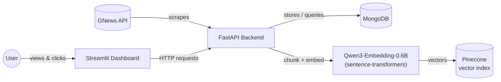

# 📰 Yazaki Morocco — News & Supply Chain Monitor

An automated news intelligence dashboard that continuously tracks what's being said — in **English, French, and Arabic** — about Yazaki, its OEM customers, its competitors, and the global shipping routes and ports its supply chain depends on. Beyond the dashboard, it also builds a **semantic index** of everything it collects, turning the article archive into something that can eventually be searched and reasoned over by meaning, not just keyword.

---

## Why this project matters

Yazaki Morocco doesn't operate in isolation. Its business is directly exposed to:

- **Its OEM customers** (Renault, Stellantis, Peugeot, Citroën, Dacia) — a slowdown, plant announcement, or strategy shift at any of them has direct downstream consequences for Yazaki's own production planning.
- **Its direct competitors** (Sumitomo Electric, Leoni, Aptiv, Lear) — knowing what competitors are doing (expansions, contract wins, plant issues) is competitive intelligence that's otherwise scattered across dozens of sources.
- **Global shipping and logistics** — a container backlog at a Chinese port, congestion at Tanger Med, or disruption in the Suez Canal / Red Sea shipping lanes can delay raw materials in or finished goods out, often with days or weeks of lead time before it's felt on the factory floor.
- **Industry-wide shocks** — semiconductor shortages and other automotive supply chain disruptions have repeatedly caused production stoppages across the whole industry in recent years.

**The problem this solves:** relevant news about all of the above is published continuously, in three different languages, across hundreds of sources — no one person can manually monitor all of it every day. This project automates that monitoring, so the people who need this information get a single dashboard instead of hours of manual searching across multiple languages and sites.

**The result:** earlier visibility into supply chain risk, competitor activity, and customer news — the kind of early warning that turns a "we found out too late" situation into "we saw this coming."

---

## What it actually does

1. **Searches for news** matching a curated keyword list — company names, ports, logistics terms — across English, French, and Arabic sources, using the [GNews API](https://gnews.io).
2. **Filters out noise** — job postings and other irrelevant matches are automatically excluded, and duplicate articles (the same story picked up by multiple keyword searches) are deduplicated.
3. **Stores everything in MongoDB**, tagged with exactly which keyword(s) each article matched.
4. **Presents an interactive dashboard** where you can:
   - See today's and this month's totals and most-mentioned keyword at a glance
   - Browse activity by day, week, or month, broken down by language
   - Click any bar in the chart to see exactly which articles are behind it
   - Filter that article list by keyword, with direct links to the original source
5. **Updates incrementally** — click "Update now" and it only fetches what's changed since the last successful run, rather than re-fetching everything every time.
6. **Extracts full article text** — click "Extract articles" and it opens each not-yet-extracted article in a real headless browser, pulls out the main body text (skipping ads/navigation/cookie banners), and saves it. Articles it can't extract automatically (paywalls, cookie walls, unusual page layouts) can be retried or have their content pasted in manually.
7. **Embeds and indexes article content** — click "Embed articles" and every successfully-extracted article is split into chunks, turned into vector embeddings, and upserted into a Pinecone vector index — the foundation for semantic search and retrieval over the whole archive (see [Semantic embeddings](#semantic-embeddings--pinecone) below).

---

## Architecture



| Layer | Technology | Role |
|---|---|---|
| Database | MongoDB | Stores articles, scrape history, extraction status/content, and embedding status/chunk ids |
| Backend | FastAPI (Python) | Scrapes GNews, matches keywords, extracts article content, chunks + embeds content, exposes a REST API |
| Frontend | Streamlit (Python) | Interactive dashboard — charts, filters, article browsing, extraction + embedding controls |
| Data source | [GNews API](https://gnews.io) | News search, title/description matching |
| Content extraction | Playwright + trafilatura | Loads each article in a headless browser and pulls out its main text |
| Embedding model | [Qwen3-Embedding-0.6B](https://huggingface.co/Qwen/Qwen3-Embedding-0.6B) via `sentence-transformers` | Turns article-text chunks into 1024-dimensional vectors, CPU inference, no LangChain |
| Vector store | [Pinecone](https://www.pinecone.io) | Stores and indexes chunk embeddings for semantic search (index name: `yazaki`, cosine metric) |
| Orchestration | Docker Compose | Runs all services together with one command, including a one-shot DB sync step |

---

## Project structure

```
news-scraper-ymo/
├── backend/
│   ├── app/
│   │   ├── main.py                  # FastAPI entrypoint (incl. startup guard/state cleanup)
│   │   ├── config.py                # Environment settings
│   │   ├── database.py              # MongoDB connection + indexes
│   │   ├── models.py                # Data schemas (ingestion_status, embedding_status, run-status docs)
│   │   ├── repository.py            # All MongoDB (and Pinecone-cleanup) queries
│   │   ├── keywords.py              # Multilingual keyword configuration
│   │   ├── routers/                 # API endpoints (articles, extraction, embedding, stats, update)
│   │   └── services/                # GNews client, keyword matching, scraping, stats,
│   │                                 # extraction, chunking, embedding
│   ├── extracted_articles/          # .txt output of successful extractions (not in a Docker volume)
│   ├── yazaki_news/                 # mongodump snapshot checked into git — see "Syncing the database"
│   ├── test_extraction.py           # Standalone Playwright/trafilatura proof-of-concept script
│   ├── requirements.txt
│   ├── Dockerfile
│   └── .env.example
├── frontend/
│   ├── app.py                       # Streamlit entrypoint
│   ├── config.py                    # Environment settings
│   ├── api_client.py                # All backend API calls
│   ├── components/                  # Overview bar (incl. embed/stop + progress), chart, article list
│   ├── requirements.txt
│   └── Dockerfile
├── sync-db.sh / sync-db.ps1         # Dumps the running DB into backend/yazaki_news/ (bash / PowerShell)
├── docker-compose.yml               # incl. the one-shot mongo-restore sync service
└── .gitignore
```

---

## Getting started

### Prerequisites

- [Docker Desktop](https://www.docker.com/products/docker-desktop/) installed and running
- A free GNews API key — [sign up here](https://gnews.io/register)
- A [Pinecone](https://www.pinecone.io) account and API key, with an index named `yazaki` created (dimension `1024`, metric `cosine`) — only needed if you plan to use the embedding feature
- (Optional) A Hugging Face token if you ever need to re-download the embedding model — see the note on the model cache below

### Setup

1. **Clone the repo:**
   ```bash
   git clone https://github.com/yassinembasskar/news-scraper-ymo.git
   cd news-scraper-ymo
   ```

2. **Configure the backend.** Copy `backend/.env.example` to `backend/.env` and fill in your real values:
   ```
   MONGO_URI=mongodb://localhost:27017
   MONGO_DB_NAME=yazaki_news
   GNEWS_API_KEY=your_actual_gnews_api_key_here
   HF_TOKEN=your_huggingface_token_here
   PINECONE_API_KEY=your_pinecone_api_key_here
   ```
   (`MONGO_URI` is automatically overridden inside Docker — no need to change it for the container setup.)

3. **Seed the embedding model cache (one-time, first setup only).** The Qwen3-Embedding-0.6B model is *not* downloaded during the Docker build — it lives in a persistent named volume (`hf-model-cache`) instead, because some corporate networks block outbound access to `huggingface.co` (see [Known limitations](#known-limitations)). On a machine with normal internet access:
   ```bash
   pip install sentence-transformers
   python -c "from sentence_transformers import SentenceTransformer; SentenceTransformer('Qwen/Qwen3-Embedding-0.6B')"
   ```
   Then copy the resulting `~/.cache/huggingface` folder into the running `backend` container's `hf-model-cache` volume via `docker cp` (start the stack first, then copy, then restart backend). If your network already reaches `huggingface.co` fine, you can skip this — the model will simply download on first use instead.

4. **Build and start everything:**
   ```bash
   docker compose up --build
   ```
   First run will take a few minutes (downloading images, installing dependencies, restoring the database from `backend/yazaki_news/`). Subsequent runs are fast — see [Common operations](#common-operations) below.

5. **Open the dashboard:**
   ```
   http://localhost:8501
   ```

---

## Using the dashboard

- **Overview bar** — today's and this month's article totals and top keyword, plus when data was last refreshed.
- **"Update now"** — triggers a fresh scrape. Safe to click anytime: if it's already up to date for today, it does nothing rather than wasting API quota. A full run takes roughly 30–60 seconds due to deliberate rate-limiting on the free GNews plan.
- **Chart** — pick Day, Week, or Month, and navigate to any specific period (not just the current one). Bars are split by language (English / French / Arabic).
- **Click any bar** — the panel below updates to show that period's total, top keyword, per-language breakdown, and the actual list of articles.
- **Keyword filter** — narrows the article list only; it never changes the chart or the summary numbers above it.

---

## Article content extraction

Every article has an `ingestion_status`, separate from whether it's been *found* by the scraper:

| Status | Meaning |
|---|---|
| `No Extraction` | Default state for every newly-scraped article — nothing attempted yet. |
| `Pending` | An extraction attempt is currently in progress for this article. |
| `Successful` | Full body text was extracted (or manually pasted) and is stored. |
| `Failed` | An attempt was made but no usable content came back (paywall, cookie wall, unsupported layout, page didn't load). |
| `Expired` | Published more than a month ago — content (if any) is purged and it's excluded from future automatic extraction. |

**"🧹 Extract articles"** (next to "Update now" in the overview bar) starts a background job and returns immediately — it doesn't block the page. Each run:
1. **Expires** any article published more than a calendar month ago, regardless of its current status, clearing its stored content (and, if it had been embedded, its Pinecone vectors and embedding fields too — see below).
2. **Extracts** every remaining `No Extraction` article: opens it in a headless Chromium browser (via Playwright), pulls the main body text with `trafilatura`, and on success saves the text both to that article's database row and to `backend/extracted_articles/{title[:40]}.txt`.
3. `Failed` articles are **not** retried automatically on the next run — that's a deliberate choice, so the job doesn't keep re-attempting articles that structurally can't be extracted. Reload the article list after a minute or two to see progress; articles show `Pending` while being worked on.

Only one extraction can run at a time (an in-memory lock) — clicking the button again while one is running just reports "already in progress" instead of starting a second one. If the backend restarts mid-run (crash or redeploy), any article left stuck at `Pending` is automatically reset to `No Extraction` on the next startup, so nothing is permanently stranded.

**Recovering `Failed` articles** — each `Failed` article in the article list gets two options:
- **🔁 Retry automatic extraction** — re-attempts just that one article synchronously (useful if the first failure was transient, e.g. a slow page load).
- **Paste content manually** — an expandable text box to paste the article's text by hand; saved exactly as a successful automatic extraction would be.

---

## Semantic embeddings & Pinecone

Every successfully-extracted article can be turned into searchable vector embeddings — the groundwork for future semantic search, "find related articles," and retrieval-augmented Q&A over the whole archive. Built with plain `sentence-transformers`, `pymongo`, and the `pinecone` client directly — no LangChain or other orchestration framework.

Each article has an `embedding_status`, independent of `ingestion_status`:

| Status | Meaning |
|---|---|
| `Not Embedded` | Default state — either never attempted, or not eligible yet (only `Successful`-extraction articles are ever candidates). |
| `Pending` | Currently being chunked/embedded/upserted. |
| `Embedded` | Its chunks are stored in Pinecone; `chunk_ids` and `number_of_chunks` are recorded on the article. |
| `Failed` | An attempt was made but something went wrong (chunking, embedding, or the Pinecone upsert); retried automatically on the next run. |

**"🧠 Embed articles"** (next to "Extract articles") starts a background job:
1. **Gathers** every article with `ingestion_status == "Successful"` and `embedding_status != "Embedded"` — a `Failed`/`Pending`/`Expired`-extraction article is never touched, enforced both by the query and by a hard guard at the database-write level.
2. **Chunks** each article's content on line breaks (`services/chunking.py`), embeds every chunk with **Qwen3-Embedding-0.6B**, and upserts the resulting vectors into the Pinecone index `yazaki` in batches, tagged with `article_id`, `url`, `order`, `language`, and the chunk's own text as metadata.
3. **Tracks live progress** in a `meta` document — total candidates, processed count, and a recency-weighted (exponential moving average) estimate of seconds-per-article, so one anomalously slow article (e.g. a cold-start warmup right after a container restart) doesn't permanently skew the ETA.
4. **Logs** one `embedding_runs` document per run (status, counts, errors) — a permanent history, separate from the `meta` document that only reflects the current/most recent run.

While a run is active, the overview bar shows a progress bar and an ETA ("X/Y articles (Z%) — expected to finish in about N min"), and the button becomes **"🛑 Stop embedding"** — this asks the run to stop after its current article finishes (there's no safe way to interrupt Python mid-computation), then resets the guard flag and any `Pending` article back to a clean state. The same guard-reset also runs automatically on backend startup, in case the process was killed outright rather than shut down cleanly.

**Expiry cleanup** — when `expire_old_content()` marks an article `Expired`, it also deletes that article's vectors from Pinecone (via its stored `chunk_ids`) in the same step, so Mongo and Pinecone never drift out of sync with each other.

---

## Configuration

**Keywords** — edit `backend/app/keywords.py` to add or remove search terms. Each language (`en`, `fr`, `ar`) has its own list, since company names need to be transliterated (not just translated) to actually match Arabic-language headlines — e.g. Renault appears as "رينو", not "Renault".

**Scrape window** — the first-ever run defaults to the last 7 days. Adjust `DAYS_BACK` in `backend/app/services/scraper.py` to change this.

**Excluded words** — `EXCLUDE_WORDS_BY_LANGUAGE` in `keywords.py` controls what gets filtered out (e.g. job postings). Add more terms per language as needed.

**Extraction expiry window** — articles are expired one calendar month after `published_at`. Adjust `EXPIRY_MONTHS` in `backend/app/services/extractor.py` to change this.

**Embedding model / index** — `EMBEDDING_MODEL_NAME` and `PINECONE_INDEX_NAME` in `backend/app/services/embedder.py` (the latter must match the constant of the same name in `repository.py`, used for the expiry-cleanup path). `UPSERT_BATCH_SIZE` / `PINECONE_DELETE_BATCH_SIZE` control Pinecone batch sizes; `RATE_EMA_ALPHA` controls how quickly the reported ETA reacts to a change in processing speed.

---

## Syncing the database between machines

The database isn't a Docker named volume shared across machines — it's local to whichever machine's Docker Desktop is running it. To carry your data (scraped articles, extraction results, embedding progress) from one machine to another, the project uses a **git-committed MongoDB dump**:

- `backend/yazaki_news/` is a `mongodump` snapshot, checked into the repo.
- The `mongo-restore` service in `docker-compose.yml` is a one-shot job that **restores this snapshot into the `mongo` container's database on every plain `docker compose up`** — that's the "pull" side of the sync.

### Running the app

```bash
docker compose up -d
```
This starts Mongo, runs `mongo-restore` (dropping and replacing the local database with whatever's in `backend/yazaki_news/`), then starts the backend and frontend. Open `http://localhost:8501`.

> ⚠️ Because `mongo-restore` runs on *every* `docker compose up`, restarting the stack always resets the database to match the committed snapshot — even if the running database had newer data that was never synced. If you're iterating on backend/frontend code and want to restart **without** touching the database, use `docker compose up -d --no-deps backend frontend` instead (recreates just those two services, skips `mongo-restore` entirely).

### Closing the app (and syncing your changes out)

Before shutting down — especially if you're about to continue on a different machine — dump the current database state into `backend/yazaki_news/` so it can be committed and pulled in elsewhere. Either run the helper script:

```powershell
# PowerShell
.\sync-db.ps1
```
```bash
# bash / Git Bash
bash sync-db.sh
```

...or, if script execution is blocked (common on locked-down corporate machines), paste these commands directly into your terminal instead — typing/pasting isn't affected by script execution policy:

```powershell
$container = docker compose ps -q mongo
docker compose exec -T mongo mongodump --uri="mongodb://localhost:27017/yazaki_news" --out=/tmp/sync-dump
Remove-Item -Recurse -Force backend\yazaki_news -ErrorAction SilentlyContinue
docker cp "${container}:/tmp/sync-dump/yazaki_news" backend\yazaki_news
docker compose exec -T mongo rm -rf /tmp/sync-dump
```

Then review and push:
```bash
git status
git add backend/yazaki_news
git commit -m "Sync database"
git push
```

On the other machine: `git pull`, then `docker compose up -d` — the fresh snapshot is restored automatically.

To actually stop the containers (without touching the database either way):
```bash
docker compose down
```

---

## Common operations

```bash
# Stop everything (containers stopped, not removed)
docker compose down

# Stop and restart later — restores the DB from backend/yazaki_news/ every time (see above)
docker compose up -d

# Restart just backend/frontend code changes, without touching the database
docker compose up -d --no-deps backend frontend

# After changing code — rebuilds only what changed
docker compose build backend frontend

# View logs for one service
docker compose logs -f backend

# Full reset — wipes the database volume too (use with caution)
docker compose down -v
```

---

## Known limitations

- **GNews free plan**: 100 requests/day, capped article results per request. A busy day with a lot of keyword chunks across three languages can approach this limit.
- **Single shared "last updated" watermark** across all languages — if one language fails during a run, the whole run is marked partial and retried together next time, rather than tracking each language independently.
- **Bucket boundaries use Morocco local time** (`Africa/Casablanca`), correctly accounting for its seasonal Ramadan time change — but this means an article published late at night UTC may appear to belong to "the next day" in the dashboard.
- **Extracted `.txt` files aren't in a Docker volume** — they're written to `backend/extracted_articles/` inside the backend container's writable layer, so they're lost on `docker compose down` (the database copy of the content survives, since Mongo's volume is separate). Add a volume mount if you need them to persist.
- **The extraction lock is in-memory and per-process** — it correctly prevents two overlapping runs within a single backend container, but wouldn't coordinate across multiple backend replicas if this were ever scaled horizontally. The embedding job's guard, by contrast, is Mongo-backed and does survive a restart.
- **No dedicated job-status endpoint for extraction** (unlike embedding, which has one) — progress is only visible by reloading the article list and watching `ingestion_status` values change.
- **Backend Docker image is heavier** — installing Chromium (`playwright install --with-deps chromium`) adds real build time and image size versus the rest of the stack.
- **Embedding is CPU-only** — no GPU acceleration. Throughput is roughly 5–20 seconds/article depending on the machine, and the very first article after a fresh container start is often markedly slower (one-time model/thread warmup) — the ETA display is recency-weighted specifically to not be thrown off by this.
- **No search/query endpoint yet** — the embedding pipeline populates Pinecone, but there's currently no API or UI feature to actually query it (semantic search, related-article lookup, RAG-style Q&A). That's the natural next step on top of this indexing infrastructure.
- **Corporate SSL inspection can block outbound HTTPS from inside Docker** on some networks (observed against both `gnews.io` and `huggingface.co`) — this is why the embedding model is seeded via a persistent volume rather than downloaded at build/run time. If you hit `SSLError: self-signed certificate in certificate chain`, this is almost certainly why; resolving it requires either the corporate proxy's CA certificate or an SSL-inspection bypass for the relevant domains from your IT department.
- **`mongo-restore` always overwrites on startup** — see [Syncing the database between machines](#syncing-the-database-between-machines). There is currently no merge option; it's drop-and-replace only.
